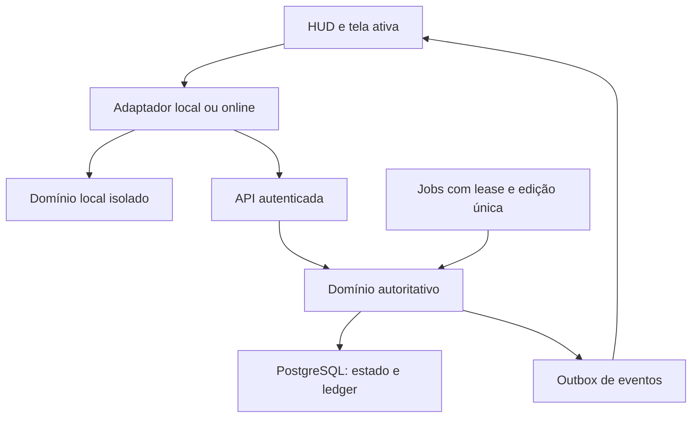

# Arquitetura proposta

Estado: fundação F1 implementada; desenho de gameplay/online permanece planejado. Cliente, servidor de diagnóstico, contratos, sessão e save local existem. Versões resolvidas e evidências em DEVELOPMENT/ADR-005; nenhuma infraestrutura externa provisionada.

## Componentes e limites

| Componente proposto | Responsabilidade | Não pode fazer |
|---|---|---|
| apps/client | Phaser para cenas/atores; HTML/CSS para menus acessíveis; input, assets e apresentação de estado | Decidir saldo/drop/resultado online |
| apps/server | API, autenticação de sessão, domínio autoritativo, persistência, jobs e eventos | Confiar em relógio, saldos ou dano do cliente |
| packages/shared | Schemas, enums, DTOs e versões de contrato | Exportar segredos, chaves de RNG ou acesso ao banco ao cliente |
| Domínio local do cliente | Simulação e fixtures isoladas para desenvolvimento | Emitir moeda online ou importar save como saldo confiável |
| PostgreSQL | Estado persistente, constraints, ledger, idempotência e outbox | Servir como substituto de validação de gameplay |
| Adaptador de plataforma | Auth, compras, anúncios e ciclo de vida web/Android | Expor SDKs específicos a todo o domínio |

Cliente: TypeScript estrito, Phaser 3, Vite e testes compatíveis com Vitest. Servidor: Node LTS verificado na F1, TypeScript, HTTP leve (Fastify proposto), WebSocket autenticado. Supabase é opção para PostgreSQL/auth; escolha final em ADR antes de integrar. Não adicionar cache distribuído ou broker na fundação sem necessidade medida.

Tudo entre cliente e API é fronteira de confiança. WebSocket transmite estado/eventos, não quadros gráficos. A integração final depende de verificação dos SDKs e serviços na ocasião; este desenho não certifica segurança de código futuro.

## Estado e cenas

Separar GameSession, store de leitura e ciclo de renderização. Cenas BattleScene/MiningScene/ProductionScene consomem snapshots; a HUD persiste. A cena oculta deixa de desenhar/capturar input, sem destruir BattleSession ou relógio do domínio. Uma compra passa por comando, não mutação direta do store pelo componente.

Domínio local usa relógio injetável, RNG controlável e passo fixo proposto de 100 ms, com fila de eventos por instante para resultados determinísticos. Acumulador visual não deve conceder renda por frame. Online, agenda de ataques e simulação são do servidor; o cliente interpola e reproduz eventos confirmados. Salvar só estado de domínio, não objetos Phaser/DOM.

## Autoridade e fluxo de comando

1. Transport recebe comando versionado e credencial.
2. Autenticador determina accountId; não aceitar ownerId enviado como autoridade.
3. Schema valida limites/tipos; verificador aplica rate limit e elegibilidade.
4. Serviço carrega agregado e versão; obtém lock/transação apropriados.
5. Domínio calcula delta, pré-condições e evento único.
6. Persistir estado, ledger, resultado da idempotência e outbox na mesma transação.
7. Só depois do commit responder e publicar evento; consumidor deduplica por eventId/sequence.

Requisição repetida retorna resultado persistido. Estado obsoleto exige atualização, não sobrescrita silenciosa. Transações com mais de uma conta bloqueiam recursos em ordem estável para reduzir deadlocks, com retry limitado de erros transitórios.

## Combate e desconexão

Um escritor lógico por BattleSession; lease/fencing impede dois workers de avançarem o mesmo combate. Eventos usam sequence monotônica por stream. Não escrever banco a cada frame; persistir checkpoints/transições/resultados conforme orçamento de recuperação e sempre persistir grants antes de anunciá-los como confirmados.

No MVP local, app oculto suspende combate e reconcilia somente minas conforme ADR-003. Online proposto: detecção de desconexão muda para política de ausência registrada no servidor; não continuar indefinidamente uma simulação perdida no navegador. Na primeira implementação online adotar pausa de combate ao perder presença, preservando deadline de boss já iniciado para impedir fuga do timeout. Revalidar decisão/tempo de heartbeat em D19 antes de ativar; produção segue independente. Navegar internamente não é ausência.

## Persistência, eventos e cache

Save local IndexedDB proposto, com schemaVersion/configVersion, snapshot atômico, backup anterior e migrações puras. Não escrever por clique; agrupar saves e persistir em transições/visibilitychange quando possível. browser unload não garante execução: autosave e operações idempotentes compensam.

Online PostgreSQL mantém saldos materializados mais ledger append-only. Outbox permite retomar publicação após crash. Não prometer entrega exatamente uma vez no transporte: idempotência produz efeito econômico único. Cache é derivado; nunca fonte de saldo. Ranking pode ter snapshot eventual com timestamp público.

## Estrutura inicial planejada

apps/client/src: game, scenes, ui, input, state, assets, persistence, platform, network, local-domain. apps/server/src: api, auth, domain, combat, economy, mining, inventory, persistence, jobs, security, observability. packages/shared: contracts, schemas, enums. Criar módulos sociais/mercado quando houver implementação, não pastas vazias para aparentar progresso.

## Publicação e observabilidade

Build do cliente distribuível em hospedagem estática/CDN; API e workers em serviço com conexões persistentes; banco em ambiente privado. Hospedagem ainda não escolhida. Desenvolvimento, staging e produção têm chaves/bancos distintos. Trace/requestId acompanha comando, transação e evento, sem tokens/PII. Métricas mínimas: latência, rejeições, grants duplicados evitados, fila outbox, falhas de save/reconexão, memória e FPS. Ver OPERATIONS e TEST_PLAN.

## Implementação visual F2

Uma cena Phaser mantém grupos exclusivos para Batalha/Mina/Produção; somente o grupo ativo é visível/animado. DOM fornece HUD, páginas e dialogs acessíveis. O renderer não muta saldos e não controla persistência. A sessão mantém lifecycle e screen; menus temporários não alteram schema. Pool de seis sprites de impacto evita criar objetos por clique. Subset curado pequeno carregado uma vez; expansão de packs requer carregamento por demanda antes de aumentar escopo.
