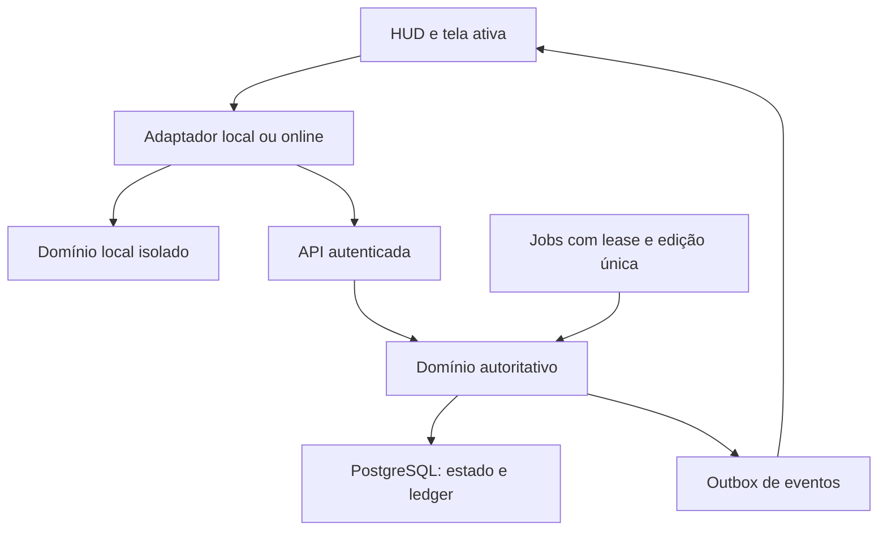

# Arquitetura proposta

Estado atual: F1–F4 locais e F5 online implementadas no escopo de desenvolvimento. [ONLINE](ONLINE.md) descreve os componentes reais e gates de ativação; [ADR-009](ADR/0009-authoritative-online.md) atualiza as decisões propostas abaixo. Nenhuma infraestrutura externa foi contratada.

F5: Fastify/PostgreSQL/cookie opaco + convidado/Google opcional, transação e lock de conta para cada liquidação. Worker de batalha sem estado em memória; duas instâncias não repetem intervalo. Snapshot+ledger+resultado+outbox atômicos. commandVersion separado de stateVersion, lease de presença3s e stream de snapshots1s; replay de eventos é consulta durável, não concessão econômica. Não há importação de save local. Blueprint abaixo inclui futuras expansões de jobs/cache/PvP; não é relação de serviços já provisionados.

## Componentes e limites

| Componente proposto | Responsabilidade | Não pode fazer |
|---|---|---|
| apps/client | Phaser para cenas/atores; HTML/CSS para menus acessíveis; input, assets e apresentação de estado | Decidir saldo/drop/resultado online |
| apps/server | API, autenticação de sessão, domínio autoritativo, persistência, jobs e eventos | Confiar em relógio, saldos ou dano do cliente |
| packages/shared | Schemas, enums, DTOs e versões de contrato | Exportar segredos, chaves de RNG ou acesso ao banco ao cliente |
| Domínio local do cliente | Simulação e fixtures isoladas para desenvolvimento | Emitir moeda online ou importar save como saldo confiável |
| PostgreSQL | Estado persistente, constraints, ledger, idempotência e outbox | Servir como substituto de validação de gameplay |
| Adaptador de plataforma | Auth, compras, anúncios e ciclo de vida web/Android | Expor SDKs específicos a todo o domínio |

Cliente: TypeScript estrito, Phaser 3, Vite e testes compatíveis com Vitest. Servidor: Node LTS verificado na F1, TypeScript, HTTP leve (Fastify proposto), WebSocket autenticado. Supabase é opção para PostgreSQL/auth; escolha final em ADR antes de integrar. Não adicionar cache distribuído ou broker na fundação sem necessidade medida.

Tudo entre cliente e API é fronteira de confiança. WebSocket transmite estado/eventos, não quadros gráficos. A integração final depende de verificação dos SDKs e serviços na ocasião; este desenho não certifica segurança de código futuro.

## Estado e cenas

Separar GameSession, store de leitura e ciclo de renderização. Cenas BattleScene/MiningScene/ProductionScene consomem snapshots; a HUD persiste. A cena oculta deixa de desenhar/capturar input, sem destruir BattleSession ou relógio do domínio. Uma compra passa por comando, não mutação direta do store pelo componente.

Domínio local usa relógio injetável, RNG controlável e passo fixo proposto de 100 ms, com fila de eventos por instante para resultados determinísticos. Acumulador visual não deve conceder renda por frame. Online, agenda de ataques e simulação são do servidor; o cliente interpola e reproduz eventos confirmados. Salvar só estado de domínio, não objetos Phaser/DOM.

## Autoridade e fluxo de comando

1. Transport recebe comando versionado e credencial.
2. Autenticador determina accountId; não aceitar ownerId enviado como autoridade.
3. Schema valida limites/tipos; verificador aplica rate limit e elegibilidade.
4. Serviço carrega agregado e versão; obtém lock/transação apropriados.
5. Domínio calcula delta, pré-condições e evento único.
6. Persistir estado, ledger, resultado da idempotência e outbox na mesma transação.
7. Só depois do commit responder e publicar evento; consumidor deduplica por eventId/sequence.

Requisição repetida retorna resultado persistido. Estado obsoleto exige atualização, não sobrescrita silenciosa. Transações com mais de uma conta bloqueiam recursos em ordem estável para reduzir deadlocks, com retry limitado de erros transitórios.

## Combate e desconexão

Um escritor lógico por BattleSession; lease/fencing impede dois workers de avançarem o mesmo combate. Eventos usam sequence monotônica por stream. Não escrever banco a cada frame; persistir checkpoints/transições/resultados conforme orçamento de recuperação e sempre persistir grants antes de anunciá-los como confirmados.

No MVP local, app oculto suspende combate e reconcilia somente minas conforme ADR-003. Online proposto: detecção de desconexão muda para política de ausência registrada no servidor; não continuar indefinidamente uma simulação perdida no navegador. Na primeira implementação online adotar pausa de combate ao perder presença, preservando deadline de boss já iniciado para impedir fuga do timeout. Revalidar decisão/tempo de heartbeat em D19 antes de ativar; produção segue independente. Navegar internamente não é ausência.

## Persistência, eventos e cache

Save local IndexedDB proposto, com schemaVersion/configVersion, snapshot atômico, backup anterior e migrações puras. Não escrever por clique; agrupar saves e persistir em transições/visibilitychange quando possível. browser unload não garante execução: autosave e operações idempotentes compensam.

Online PostgreSQL mantém saldos materializados mais ledger append-only. Outbox permite retomar publicação após crash. Não prometer entrega exatamente uma vez no transporte: idempotência produz efeito econômico único. Cache é derivado; nunca fonte de saldo. Ranking pode ter snapshot eventual com timestamp público.

## Estrutura inicial planejada

apps/client/src: game, scenes, ui, input, state, assets, persistence, platform, network, local-domain. apps/server/src: api, auth, domain, combat, economy, mining, inventory, persistence, jobs, security, observability. packages/shared: contracts, schemas, enums. Criar módulos sociais/mercado quando houver implementação, não pastas vazias para aparentar progresso.

## Publicação e observabilidade

Build do cliente distribuível em hospedagem estática/CDN; API e workers em serviço com conexões persistentes; banco em ambiente privado. Hospedagem ainda não escolhida. Desenvolvimento, staging e produção têm chaves/bancos distintos. Trace/requestId acompanha comando, transação e evento, sem tokens/PII. Métricas mínimas: latência, rejeições, grants duplicados evitados, fila outbox, falhas de save/reconexão, memória e FPS. Ver OPERATIONS e TEST_PLAN.

## Implementação visual F2

Uma cena Phaser mantém grupos exclusivos para Batalha/Mina/Produção; somente o grupo ativo é visível/animado. DOM fornece HUD, páginas e dialogs acessíveis. O renderer não muta saldos e não controla persistência. A sessão mantém lifecycle e screen; menus temporários não alteram schema. Pool de seis sprites de impacto evita criar objetos por clique. Subset curado pequeno carregado uma vez; expansão de packs requer carregamento por demanda antes de aumentar escopo.

## Implementação de domínio F3

packages/shared/src/loop.ts contém regras puras de agenda/recursos/compras/treino; o compartilhamento de código não transfere autoridade ao cliente online. LocalSession injeta relógio, aplica comandos sobre draft, valida e emite snapshot. Tick100ms só avança instantes de evento relevantes; não precisa resolver milissegundo por milissegundo. Atraso>5s é ausência, não combate acelerado.

Renderer recebe snapshots e compara HP/counters/attempt para idle/ataque/Run/morte; reduz movimento, modais e grupos ocultos não controlam o domínio. Ausência suspende ataques/transições, com exceção do prazo wall do boss, conciliado sem grants; minas integram taxa emBigInt/remainder. Pausa manual obedece à mesma regra de deadline, sem afetar minas.

Schema2 migra a versão publicada1 após validar checksum original. Save agrupa estado econômico e watermark no mesmo payload e transação IndexedDB; CAS protege gerações entre abas. Identidade de encontro é attempt, índice estável para alvo. Morte e saldo são gravados juntos, não há event log sem limite nem promessa de idempotência de rede. A implementação de ledger/outbox/autenticação permaneceF5.

## Domínio RPG F4

content.ts define IDs/curvas/raridades/categorias, rpg-schema.ts valida estado/comandos, rpg.ts resolve itens/transações/XP/drops e loop.ts aplica combate/minas. LocalSession aplica comandos tipados a drafts, valida e confirma estado inteiro. Produção integra buffs por intervalos com BigInt/remainder; renderer não participa de grants.

UI RPG tem estrutura estática e um handler delegado; não cria listeners por item ou por visita. Lista é refeita só quando inventário/equipados/filtro mudam; custos/botões se atualizam sem reconstruir toda a Forja a cada tick. Filtro/tabs são apresentação; itens, XP, pet e buffs são persistidos. Um sprite Musgo é reutilizado,10 animações/35 texturas/38 objetos. F5 deverá fornecer autoridade de servidor; reutilizar regra pura não torna saldo local confiável.

## Atualização F6 — 15/10/2026

F6 acrescenta CommunityService/CommunityEvents e migração002. Lock transacional41652006 coordena mudanças sociais e scheduler; locks de contas daF5 protegem recursos e ledger. Comandos, claims e auditoria persistidos; snapshots de comunidade por polling2s somente na área visível, mantendo sessão online/WebSocket e torre/minas separados. Calendário Intl America/Sao_Paulo, presença por intervalos confiáveis e snapshot competitivo sem tônico. Perfil local não recebe fake backend social. Desenho é piloto limitado, sem prova de escala: COMMUNITY_SYSTEMS/ADR-010.

## Atualização F7 — mercado

MarketService/migração003 acrescentam escrow persistido fora do inventário, ofertas sem reserva financeira, transações imutáveis, procedência de equipamento e cooldown por conta/ativo. Todas as operações compartilham lock social41652006 e ordenam os locks de participantes antes de conciliar; snapshots, ledger, outbox, transferência e comando confirmam juntos. Sem chamada entre servidores ou terceiro participante econômico. Expiração é lazy em leitura/comando e pelo scheduler10s, sempre segundo prazo armazenado.

UI independente em Mais→Mercado, com polling3s apenas aberta/visível, revisão explícita e comando pendente em sessionStorage por conta para recuperar resposta perdida/recarga. Perfil local e `jogar.bat` continuam separados; não há mercado artificial local. ADR-011/MARKET_SYSTEMS registram parâmetros, serialização do piloto e limites de produção.
