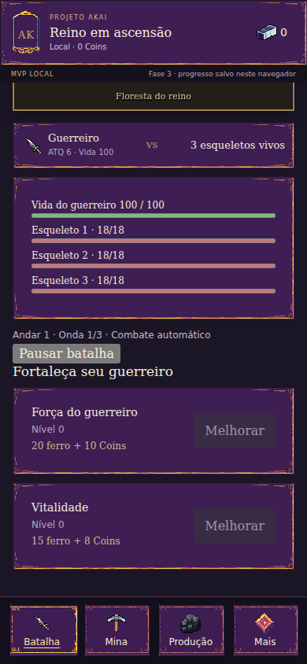
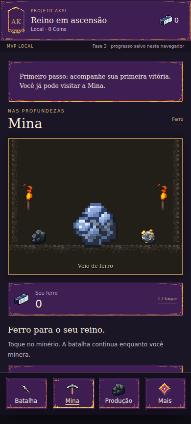
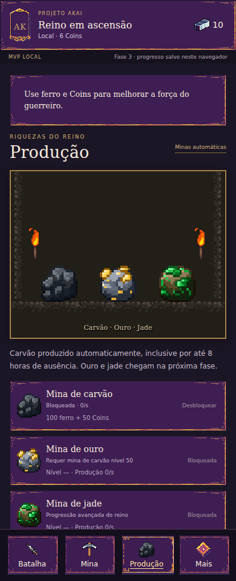
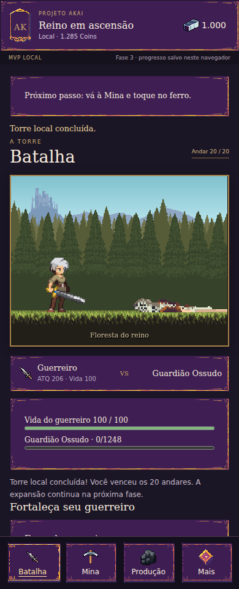

# Relatório da Fase 3 — loop local jogável

15/10/2026. Base remota: `2abdc637d2607af72c7641e1c4ca4f81681d765a`. Fase 3 concluída no escopo local, incluindo validação prolongada. Fase 4 não iniciada.

## O que foi feito

- Batalha real nos andares 1–20: três ondas de três inimigos nos comuns, Guardião Ossudo único nos bosses 10/20, HP, cooldowns, Coins por morte, transição de 3 segundos e estados de vitória/derrota.
- Prazo de boss de 30 segundos; deadline vence empate. Falha retorna ao anterior e pausa. Retry manual, pausa/retomada e treino manual no andar anterior, sem tentativas infinitas automáticas.
- Ferro inicial 1/toque; melhorias de picareta, força e vitalidade com custos exatos exibidos. Compras validam ambos os recursos antes de debitar.
- Carvão desbloqueável com 100 ferro + 50 Coins; produção automática de 0,1 × nível/s e frações preservadas. Ouro/jade e loja/equipamentos continuam nas fases previstas.
- Minas offline até oito horas, resumo já creditado, watermark persistido junto ao saldo. Zero ataques, vitórias ou cliques offline; prazo de boss iniciado pode expirar ausente.
- Save schema 2 com migração real da versão 1, mantendo perfil, saldos, tela e geração, backup/quarentena/CAS. Tutorial curto retomável e alertas de falha sem forçar a tela Batalha.
- Herói com Run rastreável e nove animações integradas ao domínio. Boss reutiliza a família Skeleton validada em escala maior; originais preservados.

## Validação

| Verificação | Evidência |
|---|---|
| `npm run check` | Hashes/grades/pivôs, TypeScript, 31 testes em 5 arquivos e builds passaram |
| Economia | Dez cliques iniciais = dez ferros; custo exato, compra sem saldo não muda estado; nível máximo/overflow protegidos |
| Combate | 3×3, transições, ataque de morto bloqueado, deadline prioritário, boss vitória/falha/timeout/retry/treino e andar 20 sem andar 21 |
| Produção | 12.347 intervalos de 1 ms equivalem ao intervalo único; remainder não se perde |
| Save | Round-trip de gameplay, migração 1→2 com SHA do payload original, corrupção/futuro/backup/CAS concorrente |
| Ausência | 24h limitadas a 8h de minas; reload/regresso não repetem crédito; boss pode expirar sem luta offline |
| Domínio prolongado | 30min simulados: intervalo único e 18.000 passos de 100ms geram estado igual |
| Smokes dev/produção | 50 ciclos, 34 texturas/37 objetos, nove animações, input oculto/modal bloqueado, pausa, menus/foco e redução de movimento |
| UI jogável no navegador | Melhoria de clique e carvão persistidos; offline/reload; boss timeout e treino; torre concluída enquanto Mina ativa; morte e asset ausente |
| Responsividade | 320/360/390/768px e844×390 horizontal, alvos ≥44px e HUD/scroll acessíveis |
| Soak real | 30min reais (1800914ms),1784 ciclos,127 listeners/34 texturas/37 objetos estáveis, heap apósGC5.91–6.64MiB e média rAF por minuto59.95–60.02 após aquecimento; [dados brutos](phase3-browser-soak.json) |
| CI remota | Pipeline executa checks, simulação e smokes; resultado do commit publicado no [workflow do GitHub](https://github.com/marmitero/projeto-akai/actions/workflows/check.yml) |

Chromium headless 153.0.8010.0, renderização por software neste ambiente. Smokes normais sem pageerrors ou respostas de assets com erro. Fixtures de teste são snapshots locais válidos, sem endpoint ou grant de debug no produto. Servidor permanece diagnóstico e bloqueia `/api/v1/*` com 503.

## Ambiente do teste prolongado

linux / x64, CPU AMD EPYC 9V74 80-Core Processor, Chromium 153.0.8010.0, viewport 390×844, renderização headless por software. 1784 ciclos em 30 minutos reais; zero pageerrors. Heap após GC entre 5.91 e 6.64 MiB; último 6.02 MiB. Listeners/texturas/objetos constantes em 127/34/37. Média rAF por minuto após os dois primeiros minutos: 59.95–60.02, mediana 60.00. Mede este ambiente, não desempenho de Android nem p95 de input. Script reproduzível em `npm run test:soak`.

## Simulação e decisão de treino

Configuração `local-loop-1`, fórmulas experimentais de BALANCE. `npm run simulate:loop` reproduz os resultados; JSON em [phase3-balance-results.json](phase3-balance-results.json).

| Cliques/s constantes | Primeira melhoria | Carvão | Boss 10 | Torre 20 |
|---|---|---|---|---|
| 1 | 20s | 144s | 344s | 2286s |
| 3 | 15s | 80s | 308s | 1118s |
| 5 | 15s | 80s | 308s | 1118s |

Política determinística de compras/treino descrita no script. Sem anúncio, pagamento ou recursos injetados. Não é expectativa de sessão humana: cliques são constantes e a política conhece o próximo boss. Início ficou mais rápido que as hipóteses originais; manter como experimento e playtestar antes de rebalancear.

A primeira execução mostrou falta irrecuperável de Coins no boss 20 dos perfis 3/5: mais ferro não bastava. Por isso foi acrescentado **Treinar no andar anterior**. O jogador solicita uma execução do 9/19 e volta a pausar após concluir. Com isso os três perfis ativos concluem sem alterar as fórmulas nem criar auto-retry de boss. Perfil sem cliques não consegue fortalecimento suficiente. Ver [ADR-007](ADR/0007-local-loop.md).

## Capturas da entrega

## Decisões autônomas

Motor por agenda/inteiros, alvo frontal, cura entre andares/tentativas, limite experimental de nível 100, BigInt em milésimos/remainder, cap de minas 8h, schema 2 com migração real e ausência sem combate. Prazo de boss corre também pausado/ausente. Treino manual evita softlock econômico preservando pausa/retry. Guardião Ossudo usa arte Skeleton validada e Run deriva do Character. Sem gasto, serviço pago, alteração de pilar ou ativação online.

## Completude, pendências e próximo passo

F3 concluída no escopo de implementação e validação local. Não há decisão obrigatória do usuário. Licenças/proveniência, Android/WebGL em aparelho e playtest humano continuam necessários antes de distribuição/expansão comercial. Headless/software não comprova desempenho em celular. Avisos conhecidos de chunk Phaser/comentários de dependência não impedem builds.

O jogo salva neste navegador; fechamento abrupto pode perder ações desde o último autosave de até 15s. SHA não é anticheat e save local não vira saldo online. Sem loot, XP, pets, equipamentos, receitas, ouro/jade ou premium implementados nesta etapa.

Próximo passo recomendado: F4 — dados e curvas escaláveis de progressão RPG, inventário/equipamentos/raridades e fabricação; depois mascotes e ouro/jade. Manter a meta de 1.000 andares, sem extrapolar as exponenciais locais além de 20 sem simulação. Ajustes de ritmo devem ser versionados e acompanhados de evidência.
