# Visual Catalog — Projeto Akai

Catálogo baseado no snapshot `367032aff1b4d41c99f8bdb963acedfc0eea96d1`. Consulte o [Manifesto](Asset_Manifest.md) para todos os arquivos e o [Guia de aplicação](Asset_Usage_Guide.md) para recortes, navegação, escala e restrições.

## Como ler

As folhas de contato mostram a imagem inteira reduzida, com o caminho impresso; imagens pequenas foram ampliadas 3× com nearest-neighbor. O fundo cinza é só suporte de inspeção, não faz parte do asset. JPEG é uma prévia: carregar sempre o PNG original no jogo. As legendas podem quebrar em três linhas; caminhos integrais estão no JSON e nas páginas do inventário.

Cobertura visual: todos os PNGs de Acessories, Assets, Backgrounds, Character, Effects, Equipments, Hud, Materials, Mine, Misc e Tiles; amostras por família de Enemies e Boss. Não há revisão individual de todos os quadros, peças ou fontes editáveis. As 18 famílias de boss estão representadas. Licenças de todos os packs permanecem pendentes.

## Seleção inicial por tela

| Tela | Aparência proposta | Seleção |
|---|---|---|
| Batalha | Fantasia medieval lateral em pixel art | Herói Character + Skeleton/Archer selecionados + Normal BG; testar um boss cartoon por vez |
| Mina | Piso escuro e nó metálico com impacto de poeira | Floor Tiles1 + ironNode + Icon31_15 + picareta Icon292 |
| Produção | Minas de recursos com gestão de níveis | coalNode/goldNode/jadeNode e lingotes correspondentes; molduras Hud |
| Mochila | Itens em grade sobre moldura consistente | Ícones de Equipments/Acessories/Misc + Hud Frame |
| Loja e Mais | Mesma linguagem de abas e painéis | Hud + ícones de produtos; maleta Icon291 para Loja e optionsButton para Mais |

As escolhas de estilo/uso são propostas de integração. Na auditoria original não havia composição. A F2 acrescentou capturas de runtime abaixo; teste em dispositivo físico continua pendente. Não interpretar a escolha de um boss como balanceamento de um andar específico.

## Acessories

20 ícones pixel art: 10 anéis e 10 pingentes. Usar em slots e detalhes de equipamento; não são camadas de personagem.

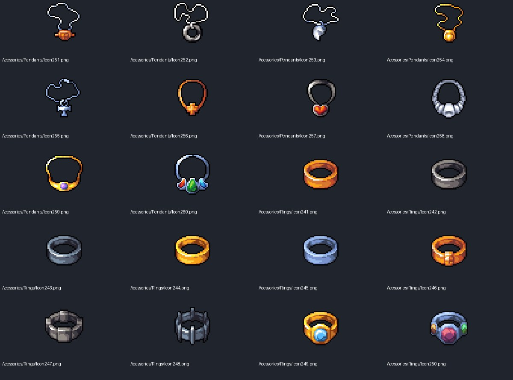

| Subfamília | Arquivos | Formatos | Dimensões PNG mais comuns |
|---|---:|---|---|
| Pendants | 10 | .png: 10 | 32×32 (10) |
| Rings | 10 | .png: 10 | 32×32 (10) |

## Assets

Atlas Decor, tira Torch, árvores/salgueiros sazonais, nuvens e sol. Cenografia; recortes do atlas e animação de tocha ainda pendentes.

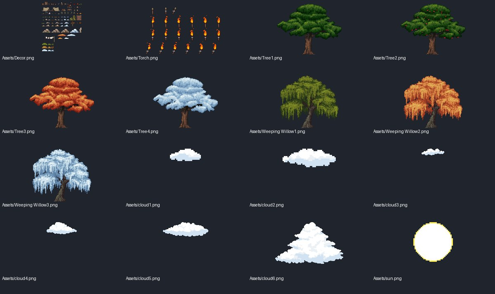

| Subfamília | Arquivos | Formatos | Dimensões PNG mais comuns |
|---|---:|---|---|
| (raiz) | 16 | .png: 16 | 256×208 (4), 224×192 (3), 416×544 (1) |

## Backgrounds

Normal, Autumn e Winter: cinco camadas e um castelo por conjunto, todos 1024×346. Fundos laterais em parallax, não mapas top-down.

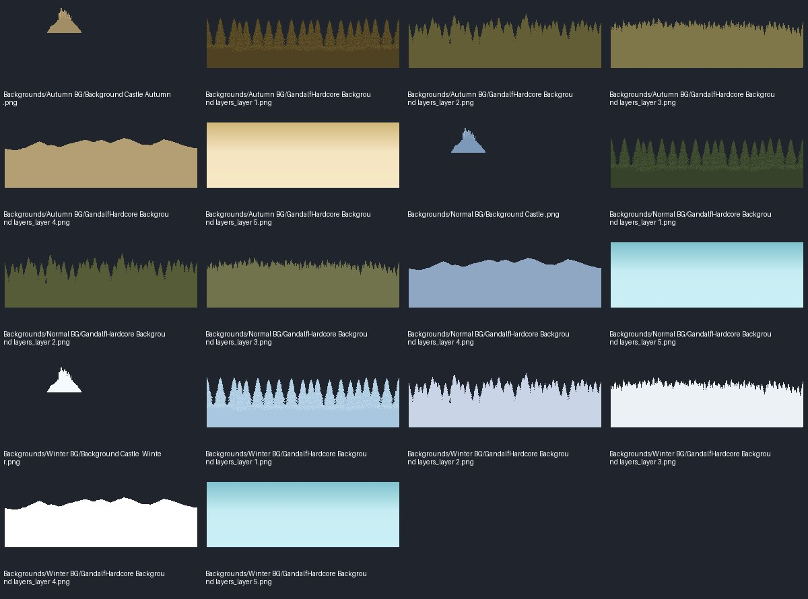

| Subfamília | Arquivos | Formatos | Dimensões PNG mais comuns |
|---|---:|---|---|
| Autumn BG | 6 | .png: 6 | 1024×346 (6) |
| Normal BG | 6 | .png: 6 | 1024×346 (6) |
| Winter BG | 6 | .png: 6 | 1024×346 (6) |

## Boss

18 famílias. Doze packs cartoon com quatro direções e fontes/rig; três robots e três trolls em sequências separadas, com maior resolução e outro acabamento. Escolher um pipeline por ator.

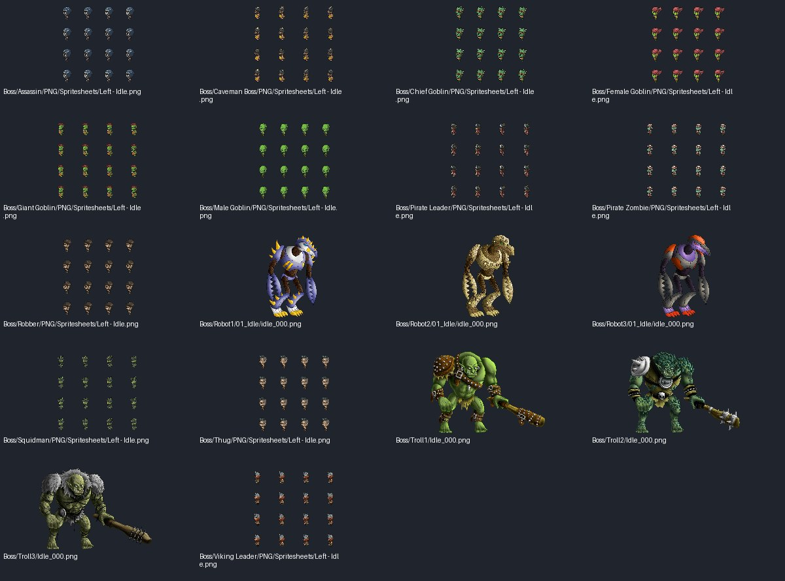

| Subfamília | Arquivos | Formatos | Dimensões PNG mais comuns |
|---|---:|---|---|
| Assassin | 456 | (none): 1, .ai: 1, .eps: 49, .png: 403, .scml: 2 | 480×480 (330), 80×80 (24), 2400×960 (9) |
| Caveman Boss | 457 | (none): 3, .ai: 1, .eps: 49, .png: 403, .scml: 1 | 840×720 (330), 4200×1440 (9), 100×100 (8) |
| Chief Goblin | 458 | (none): 3, .ai: 1, .eps: 49, .png: 403, .scml: 2 | 480×480 (330), 80×80 (24), 2400×960 (9) |
| Female Goblin | 458 | (none): 3, .ai: 1, .eps: 49, .png: 403, .scml: 2 | 480×480 (330), 80×80 (24), 2400×960 (9) |
| Giant Goblin | 455 | (none): 1, .ai: 1, .eps: 49, .png: 403, .scml: 1 | 840×720 (330), 4200×1440 (9), 100×100 (8) |
| Male Goblin | 456 | (none): 1, .ai: 1, .eps: 49, .png: 403, .scml: 2 | 480×480 (330), 80×80 (24), 2400×960 (9) |
| Pirate Leader | 458 | (none): 3, .ai: 1, .eps: 49, .png: 403, .scml: 2 | 840×720 (330), 4200×1440 (9), 100×100 (8) |
| Pirate Zombie | 458 | (none): 3, .ai: 1, .eps: 49, .png: 403, .scml: 2 | 840×720 (330), 4200×1440 (9), 100×100 (8) |
| Robber | 456 | (none): 1, .ai: 1, .eps: 49, .png: 403, .scml: 2 | 480×480 (330), 80×80 (24), 2400×960 (9) |
| Robot1 | 162 | .png: 162 | 3766×1878 (20), 1532×1315 (18), 3552×1294 (16) |
| Robot2 | 170 | .png: 170 | 877×1163 (20), 3765×1878 (20), 1531×1315 (18) |
| Robot3 | 162 | .png: 162 | 3765×1880 (20), 1533×1319 (18), 3552×1296 (16) |
| Squidman | 457 | (none): 2, .ai: 1, .eps: 49, .png: 403, .scml: 2 | 840×720 (330), 4200×1440 (9), 100×100 (8) |
| Thug | 456 | (none): 1, .ai: 1, .eps: 49, .png: 403, .scml: 2 | 480×480 (330), 80×80 (24), 2400×960 (9) |
| Troll1 | 70 | .png: 70 | 1598×1323 (10), 1183×931 (10), 1190×938 (10) |
| Troll2 | 70 | .png: 70 | 1613×1401 (10), 1183×964 (10), 1192×929 (10) |
| Troll3 | 69 | .png: 69 | 1639×1391 (10), 1200×964 (10), 1223×960 (10) |
| Viking Leader | 456 | (none): 2, .ai: 1, .eps: 49, .png: 403, .scml: 1 | 840×720 (330), 4200×1440 (8), 100×100 (8) |

## Character

Herói de cabelo branco, roupa escura e espada, em pixel art lateral. Sete PNG sheets, GIFs e fontes Aseprite. Idle/Attack/Run/Dead são o núcleo do combate.

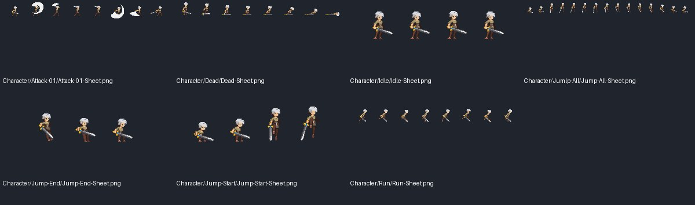

| Subfamília | Arquivos | Formatos | Dimensões PNG mais comuns |
|---|---:|---|---|
| Attack-01 | 3 | .aseprite: 1, .gif: 1, .png: 1 | 768×80 (1) |
| Dead | 3 | .aseprite: 1, .gif: 1, .png: 1 | 640×64 (1) |
| Idle | 3 | .aseprite: 1, .gif: 1, .png: 1 | 256×80 (1) |
| Jumlp-All | 3 | .aseprite: 2, .png: 1 | 960×64 (1) |
| Jump | 2 | .aseprite: 1, .gif: 1 | — |
| Jump-End | 3 | .aseprite: 1, .gif: 1, .png: 1 | 192×64 (1) |
| Jump-Start | 2 | .aseprite: 1, .png: 1 | 256×64 (1) |
| Run | 3 | .aseprite: 1, .gif: 1, .png: 1 | 640×80 (1) |

## Effects

64 PNGs de efeitos, seis GIFs de demonstração. Famílias de fogo, magia, poeira, impactos, buffs e debuffs; várias ações por atlas. Mapear frames antes de animar.

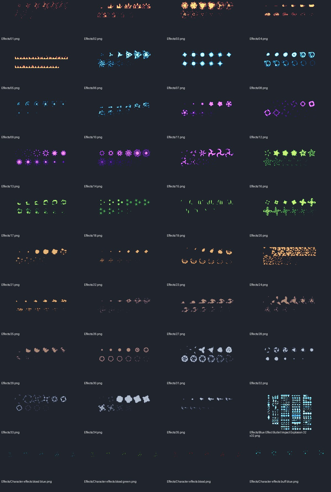

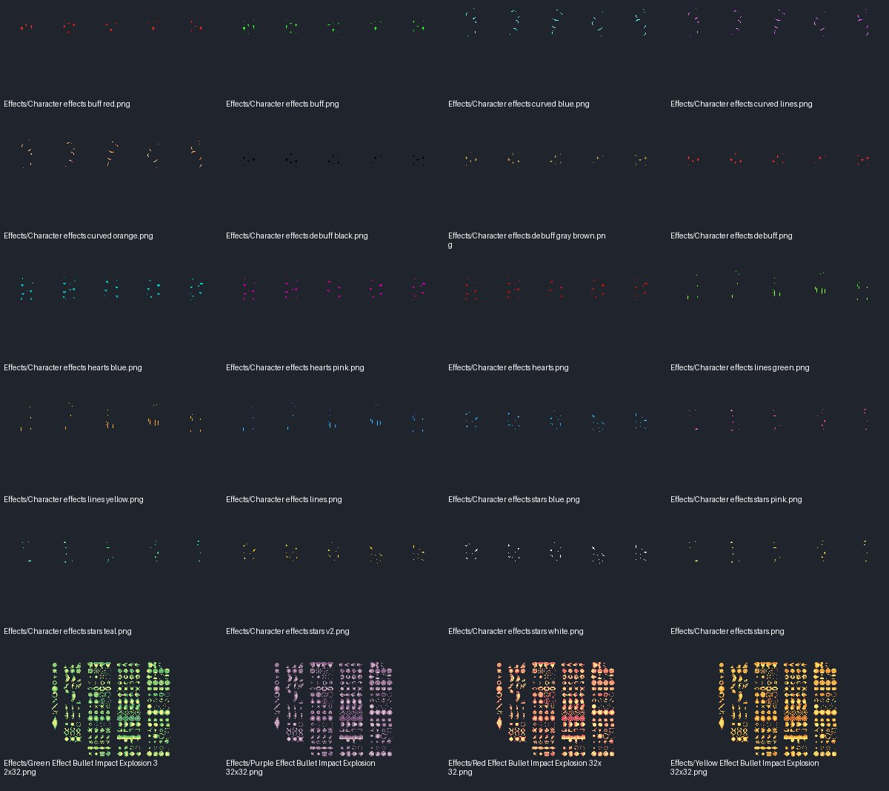

| Subfamília | Arquivos | Formatos | Dimensões PNG mais comuns |
|---|---:|---|---|
| (raiz) | 70 | .gif: 6, .png: 64 | 192×64 (35), 400×64 (24), 640×512 (5) |

## Enemies

19 famílias, incluindo duas bases modulares. Há arqueiro, esqueletos, inquisidor, sombra, morcego, cogumelo, slime, guerreiro, zumbis e monstros cartoon. A mistura precisa de seleção artística.

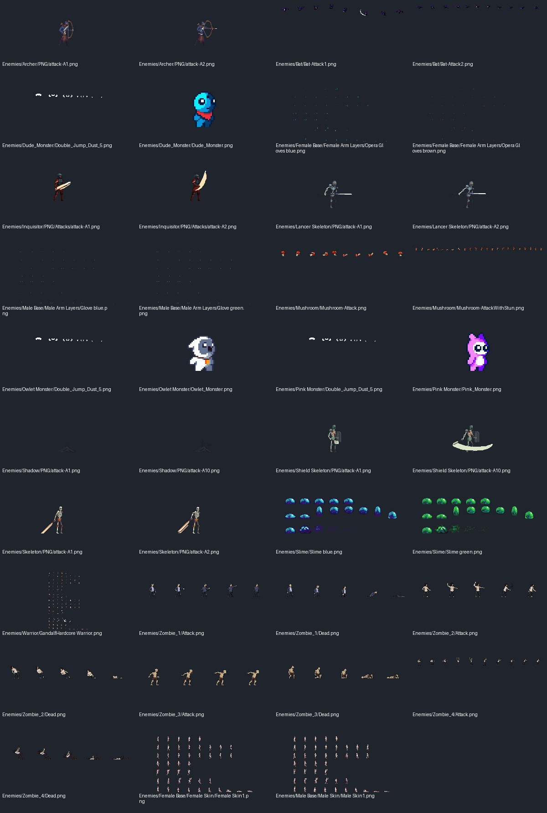

| Subfamília | Arquivos | Formatos | Dimensões PNG mais comuns |
|---|---:|---|---|
| Archer | 44 | .png: 40, .psd: 4 | 128×96 (40) |
| Bat | 8 | .png: 8 | 512×64 (2), 704×64 (1), 768×64 (1) |
| Dude_Monster | 17 | .png: 17 | 192×32 (6), 128×32 (5), 256×32 (2) |
| Female Base | 167 | .png: 167 | 800×448 (162), 720×448 (5) |
| Inquisitor | 156 | .png: 145, .psd: 11 | 128×96 (139), 128×128 (6) |
| Lancer Skeleton | 40 | .png: 36, .psd: 4 | 128×96 (36) |
| Male Base | 124 | .png: 124 | 800×448 (119), 720×448 (5) |
| Mushroom | 7 | .png: 7 | 800×64 (1), 1920×64 (1), 1200×64 (1) |
| Owlet Monster | 17 | .png: 17 | 192×32 (6), 128×32 (5), 256×32 (2) |
| Pink Monster | 17 | .png: 17 | 192×32 (6), 128×32 (5), 256×32 (2) |
| Shadow | 46 | .png: 45, .psd: 1 | 128×96 (45) |
| Shield Skeleton | 47 | .png: 43, .psd: 4 | 128×96 (43) |
| Skeleton | 46 | .png: 42, .psd: 4 | 128×96 (42) |
| Slime | 5 | .ase: 1, .gif: 1, .png: 3 | 256×96 (3) |
| Warrior | 1 | .png: 1 | 800×1088 (1) |
| Zombie_1 | 5 | .png: 5 | 640×128 (2), 512×128 (1), 768×128 (1) |
| Zombie_2 | 5 | .png: 5 | 640×128 (2), 512×128 (1), 768×128 (1) |
| Zombie_3 | 5 | .png: 5 | 512×128 (2), 640×128 (1), 768×128 (1) |
| Zombie_4 | 5 | .png: 5 | 1280×128 (1), 640×128 (1), 512×128 (1) |

## Equipments

240 ícones pixel art em 12 subpastas. A pasta Arrows contém desenhos de arcos e bestas, não apenas flechas; o nome do diretório não define o tipo de arma. Ícones não são sprites de arma equipável no corpo.

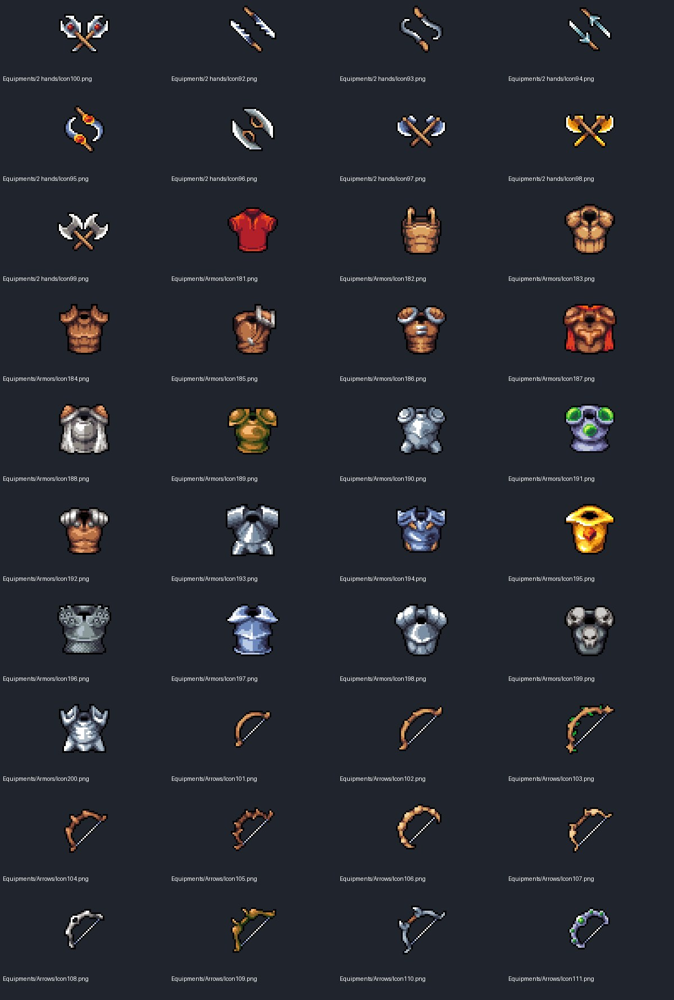

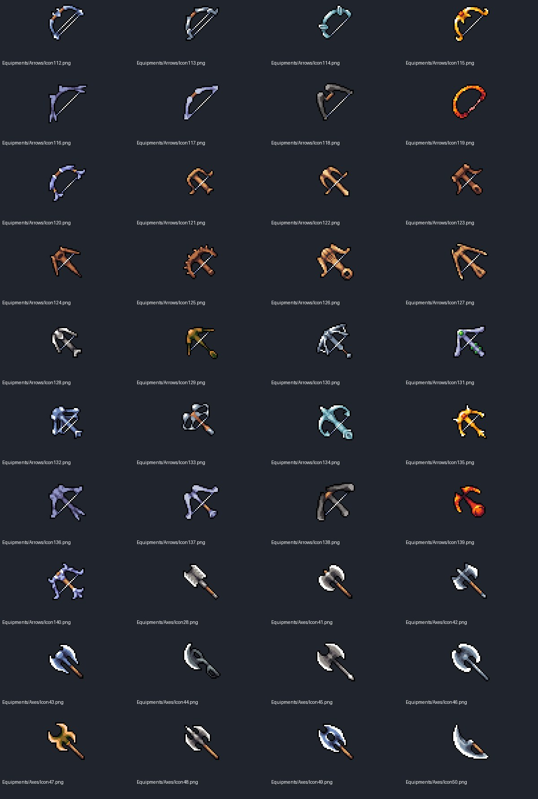

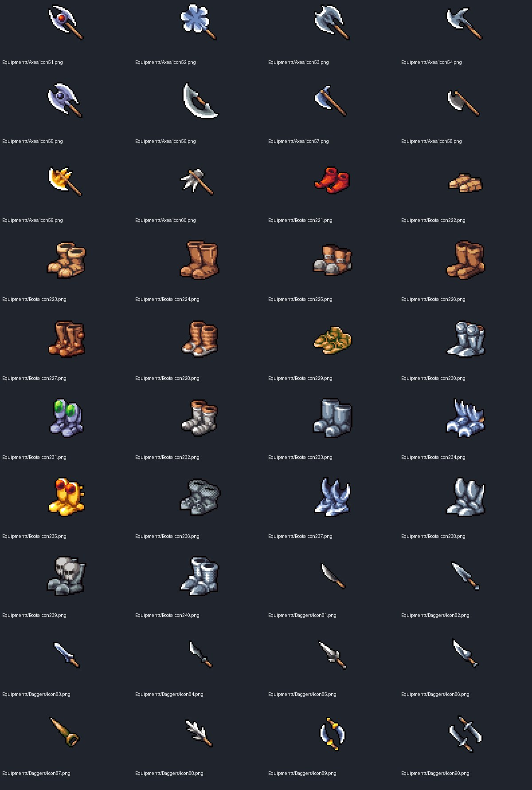

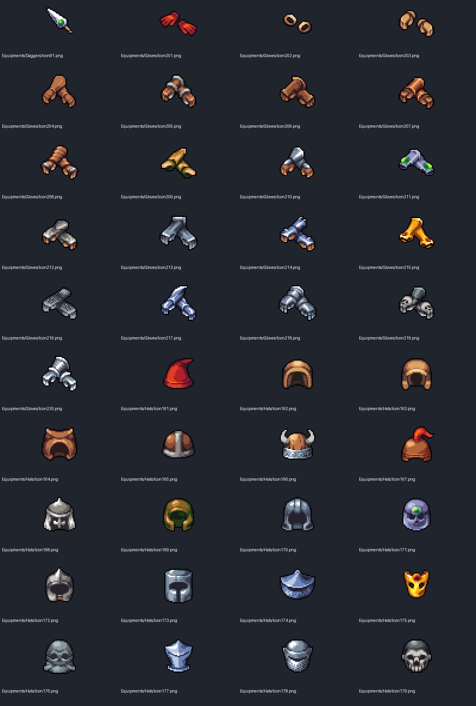

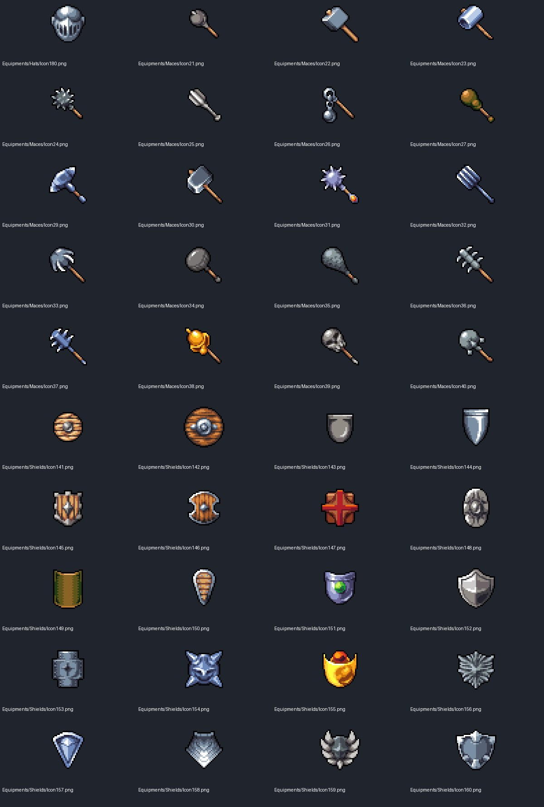

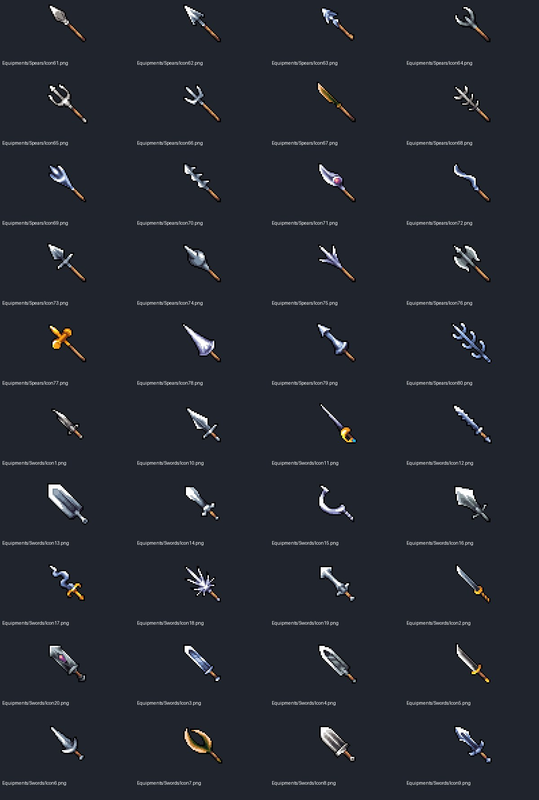

| Subfamília | Arquivos | Formatos | Dimensões PNG mais comuns |
|---|---:|---|---|
| 2 hands | 9 | .png: 9 | 32×32 (9) |
| Armors | 20 | .png: 20 | 32×32 (20) |
| Arrows | 40 | .png: 40 | 32×32 (40) |
| Axes | 21 | .png: 21 | 32×32 (21) |
| Boots | 20 | .png: 20 | 32×32 (20) |
| Daggers | 11 | .png: 11 | 32×32 (11) |
| Gloves | 20 | .png: 20 | 32×32 (20) |
| Hats | 20 | .png: 20 | 32×32 (20) |
| Maces | 19 | .png: 19 | 32×32 (19) |
| Shields | 20 | .png: 20 | 32×32 (20) |
| Spears | 20 | .png: 20 | 32×32 (20) |
| Swords | 20 | .png: 20 | 32×32 (20) |

## Hud

51 PNGs com painéis, abas, botões, barras, cursores e molduras. Roxo/dourado combina com fantasia; estados vêm em tiras. Sem fonte nem retrato de rei.

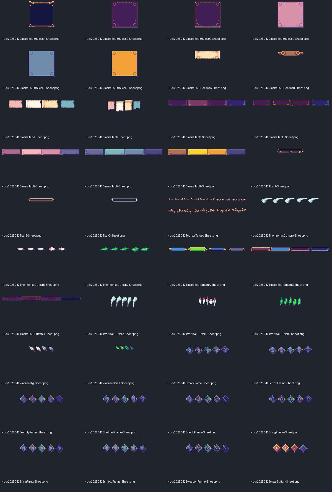

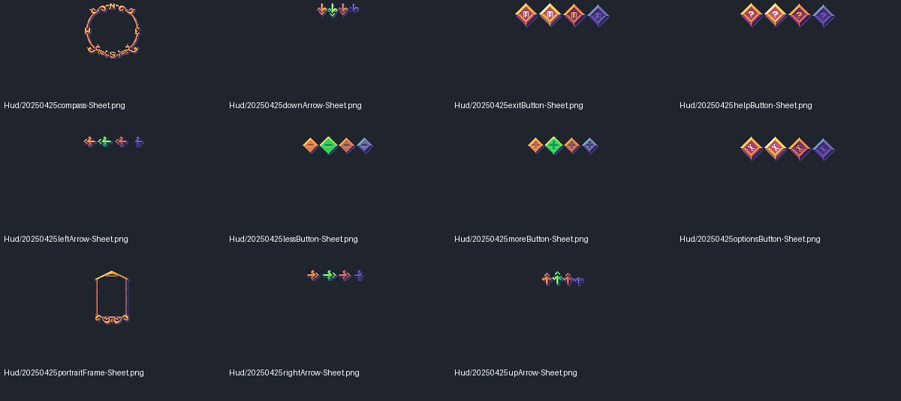

| Subfamília | Arquivos | Formatos | Dimensões PNG mais comuns |
|---|---:|---|---|
| (raiz) | 51 | .png: 51 | 160×32 (9), 96×96 (6), 384×32 (5) |

## Materials

38 ícones: ferramentas, minérios, fragmentos e lingotes. Não existem Icon31_36/37. As associações de ferro/carvão/ouro/jade vêm do prompt, não da numeração.

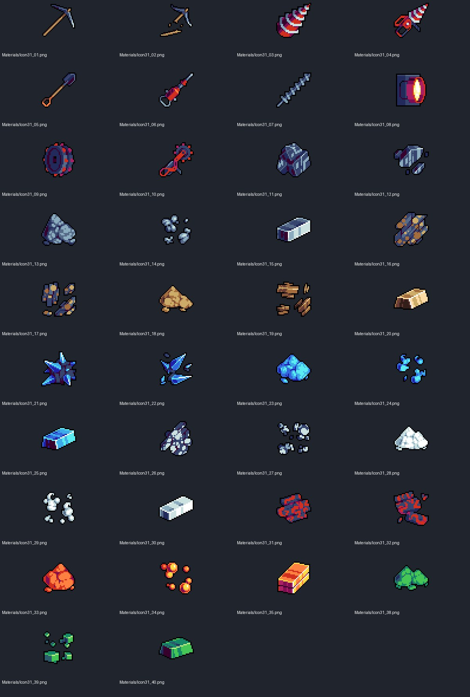

| Subfamília | Arquivos | Formatos | Dimensões PNG mais comuns |
|---|---:|---|---|
| (raiz) | 38 | .png: 38 | 32×32 (38) |

## Mine

Quatro nós pixel art estáticos 16×16: carvão, ouro, ferro e jade. Ferro é clicker; os outros identificam minas automáticas. Não são animações.

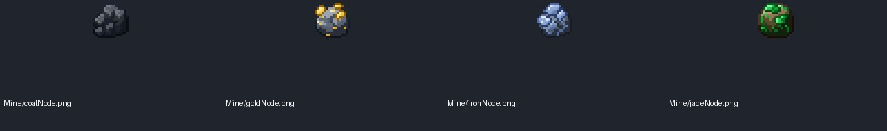

| Subfamília | Arquivos | Formatos | Dimensões PNG mais comuns |
|---|---:|---|---|
| (raiz) | 4 | .png: 4 | 16×16 (4) |

## Misc

140 ícones: 80 gemas de enchantment, 9 loots, 26 poções, 10 runas, 15 ferramentas/bolsas/livros. Poções e runas não criam por si novas mecânicas de consumo.

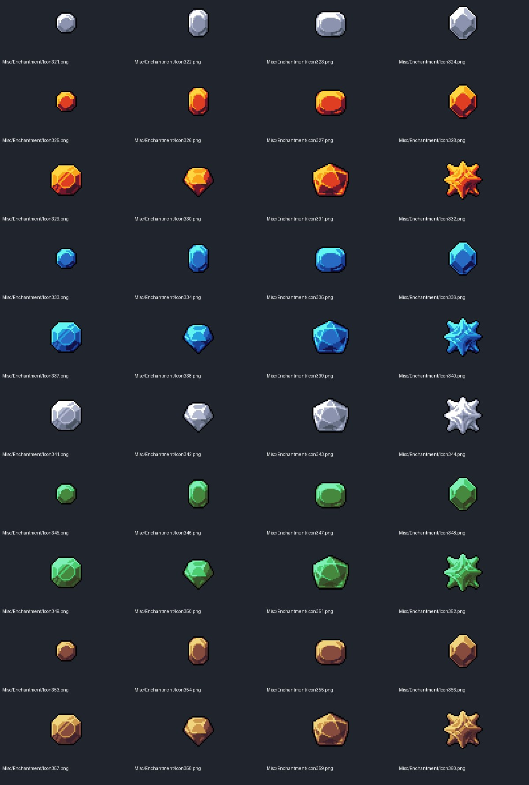

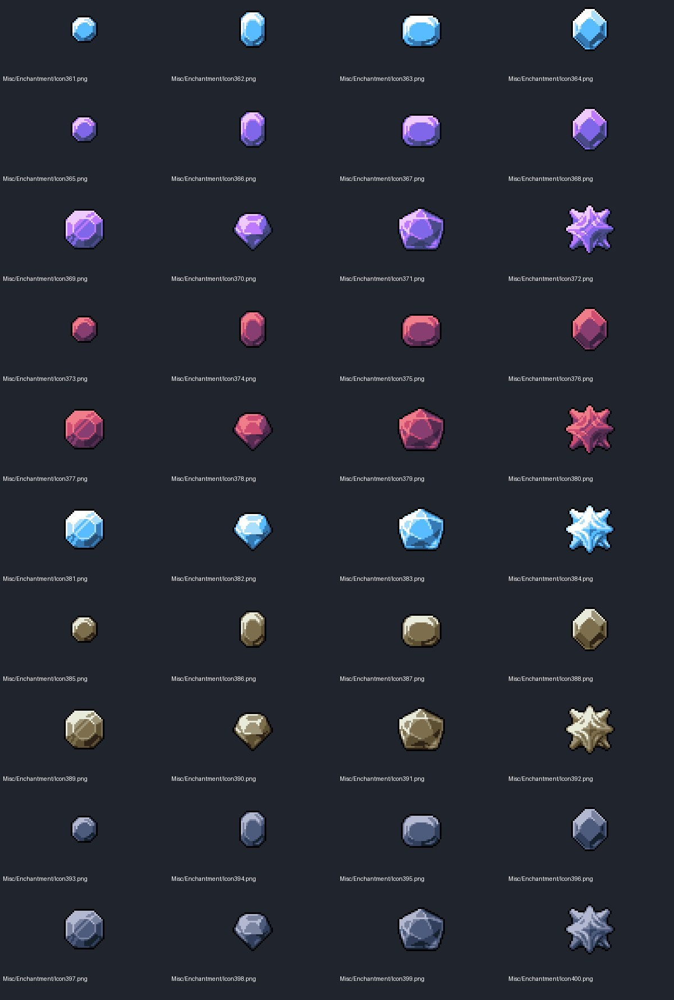

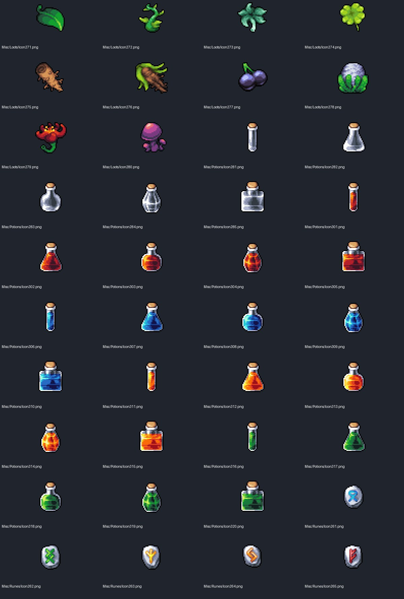

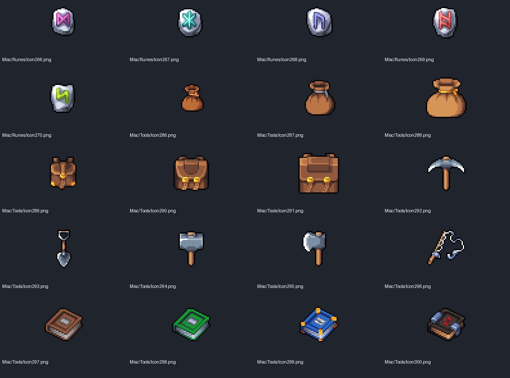

| Subfamília | Arquivos | Formatos | Dimensões PNG mais comuns |
|---|---:|---|---|
| Enchantment | 80 | .png: 80 | 32×32 (80) |
| Loots | 10 | .png: 10 | 32×32 (10) |
| Potions | 25 | .png: 25 | 32×32 (25) |
| Runes | 10 | .png: 10 | 32×32 (10) |
| Tools | 15 | .png: 15 | 32×32 (15) |

## Tiles

Dois atlas de pisos/bordas e Tall Grass. Montar chão a partir de recortes; não repetir o atlas inteiro.

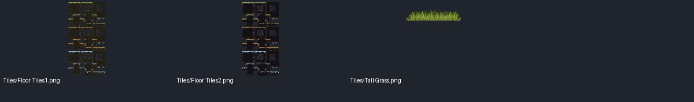

| Subfamília | Arquivos | Formatos | Dimensões PNG mais comuns |
|---|---:|---|---|
| (raiz) | 3 | .png: 3 | 288×576 (2), 96×32 (1) |

## Lacunas e incompatibilidades

- Retrato do rei: há moldura, mas não retrato oficialmente identificado. Não usar o herói inteiro como substituição silenciosa.
- Mascotes: monstros pequenos são candidatos visuais; nenhuma identidade de mascote aprovada.
- Coin: associação visual definitiva pendente. Ruby: gema Icon328 é candidata proposta.
- Tipografia e áudio: não há fontes ou arquivos de som em sprites/.
- Mina industrial: não há família confirmada de máquinas; Produção usa identidade de minas de recursos.
- Estilos: herói e ícones pixel art, bosses cartoon de quatro vistas, robots/trolls detalhados. Escala não resolve sozinha diferenças de acabamento e proporção.
- Bases modulares: ainda faltam mapa de ações/direções, pivôs e validação de sobreposição; não gerar centenas de combinações aprovadas apenas por contagem de arquivos.
- Licenças: nenhum documento de licença encontrado; origem, atribuição e permissões comerciais pendentes para todos os packs.

## Índice técnico de sequências PNG

A tabela abaixo agrupa arquivos por diretório e prefixo anterior ao índice numérico. É um índice de sequências candidatas, não prova de que todos os frames/ações foram aprovados. Ordenar índices numericamente; FPS e pivô são desconhecidos, salvo as animações do herói corroboradas por GIF no guia. Frames duplicados podem ser intencionais.

| Diretório | Prefixo | PNGs | Dimensões observadas |
|---|---|---:|---|
| `sprites/Boss/Assassin/PNG/PNG Sequences/Back - Attacking` | `Back - Attacking_` | 10 | 480×480 |
| `sprites/Boss/Assassin/PNG/PNG Sequences/Back - Hurt` | `Back - Hurt_` | 10 | 480×480 |
| `sprites/Boss/Assassin/PNG/PNG Sequences/Back - Idle` | `Back - Idle_` | 16 | 480×480 |
| `sprites/Boss/Assassin/PNG/PNG Sequences/Back - Running` | `Back - Running_` | 12 | 480×480 |
| `sprites/Boss/Assassin/PNG/PNG Sequences/Back - Walking` | `Back - Walking_` | 20 | 480×480 |
| `sprites/Boss/Assassin/PNG/PNG Sequences/Dying` | `Dying_` | 10 | 480×480 |
| `sprites/Boss/Assassin/PNG/PNG Sequences/Front - Attacking` | `Front - Attacking_` | 10 | 480×480 |
| `sprites/Boss/Assassin/PNG/PNG Sequences/Front - Hurt` | `Front - Hurt_` | 10 | 480×480 |
| `sprites/Boss/Assassin/PNG/PNG Sequences/Front - Idle` | `Front - Idle_` | 16 | 480×480 |
| `sprites/Boss/Assassin/PNG/PNG Sequences/Front - Idle Blinking` | `Front - Idle Blinking_` | 16 | 480×480 |
| `sprites/Boss/Assassin/PNG/PNG Sequences/Front - Running` | `Front - Running_` | 12 | 480×480 |
| `sprites/Boss/Assassin/PNG/PNG Sequences/Front - Walking` | `Front - Walking_` | 20 | 480×480 |
| `sprites/Boss/Assassin/PNG/PNG Sequences/Left - Attacking` | `Left - Attacking_` | 10 | 480×480 |
| `sprites/Boss/Assassin/PNG/PNG Sequences/Left - Hurt` | `Left - Hurt_` | 10 | 480×480 |
| `sprites/Boss/Assassin/PNG/PNG Sequences/Left - Idle` | `Left - Idle_` | 16 | 480×480 |
| `sprites/Boss/Assassin/PNG/PNG Sequences/Left - Idle Blinking` | `Left - Idle Blinking_` | 16 | 480×480 |
| `sprites/Boss/Assassin/PNG/PNG Sequences/Left - Running` | `Left - Running_` | 12 | 480×480 |
| `sprites/Boss/Assassin/PNG/PNG Sequences/Left - Walking` | `Left - Walking_` | 20 | 480×480 |
| `sprites/Boss/Assassin/PNG/PNG Sequences/Right - Attacking` | `Right - Attacking_` | 10 | 480×480 |
| `sprites/Boss/Assassin/PNG/PNG Sequences/Right - Hurt` | `Right - Hurt_` | 10 | 480×480 |
| `sprites/Boss/Assassin/PNG/PNG Sequences/Right - Idle` | `Right - Idle_` | 16 | 480×480 |
| `sprites/Boss/Assassin/PNG/PNG Sequences/Right - Idle Blinking` | `Right - Idle Blinking_` | 16 | 480×480 |
| `sprites/Boss/Assassin/PNG/PNG Sequences/Right - Running` | `Right - Running_` | 12 | 480×480 |
| `sprites/Boss/Assassin/PNG/PNG Sequences/Right - Walking` | `Right - Walking_` | 20 | 480×480 |
| `sprites/Boss/Assassin/PNG/Vector Parts` | `Slash FX ` | 3 | 180×180 |
| `sprites/Boss/Caveman Boss/PNG/PNG Sequences/Back - Attacking` | `Back - Attacking_` | 10 | 840×720 |
| `sprites/Boss/Caveman Boss/PNG/PNG Sequences/Back - Hurt` | `Back - Hurt_` | 10 | 840×720 |
| `sprites/Boss/Caveman Boss/PNG/PNG Sequences/Back - Idle` | `Back - Idle_` | 16 | 840×720 |
| `sprites/Boss/Caveman Boss/PNG/PNG Sequences/Back - Running` | `Back - Running_` | 12 | 840×720 |
| `sprites/Boss/Caveman Boss/PNG/PNG Sequences/Back - Walking` | `Back - Walking_` | 20 | 840×720 |
| `sprites/Boss/Caveman Boss/PNG/PNG Sequences/Dying` | `Dying_` | 10 | 840×720 |
| `sprites/Boss/Caveman Boss/PNG/PNG Sequences/Front - Attacking` | `Front - Attacking_` | 10 | 840×720 |
| `sprites/Boss/Caveman Boss/PNG/PNG Sequences/Front - Hurt` | `Front - Hurt_` | 10 | 840×720 |
| `sprites/Boss/Caveman Boss/PNG/PNG Sequences/Front - Idle` | `Front - Idle_` | 16 | 840×720 |
| `sprites/Boss/Caveman Boss/PNG/PNG Sequences/Front - Idle Blinking` | `Front - Idle Blinking_` | 16 | 840×720 |
| `sprites/Boss/Caveman Boss/PNG/PNG Sequences/Front - Running` | `Front - Running_` | 12 | 840×720 |
| `sprites/Boss/Caveman Boss/PNG/PNG Sequences/Front - Walking` | `Front - Walking_` | 20 | 840×720 |
| `sprites/Boss/Caveman Boss/PNG/PNG Sequences/Left - Attacking` | `Left - Attacking_` | 10 | 840×720 |
| `sprites/Boss/Caveman Boss/PNG/PNG Sequences/Left - Hurt` | `Left - Hurt_` | 10 | 840×720 |
| `sprites/Boss/Caveman Boss/PNG/PNG Sequences/Left - Idle` | `Left - Idle_` | 16 | 840×720 |
| `sprites/Boss/Caveman Boss/PNG/PNG Sequences/Left - Idle Blinking` | `Left - Idle Blinking_` | 16 | 840×720 |
| `sprites/Boss/Caveman Boss/PNG/PNG Sequences/Left - Running` | `Left - Running_` | 12 | 840×720 |
| `sprites/Boss/Caveman Boss/PNG/PNG Sequences/Left - Walking` | `Left - Walking_` | 20 | 840×720 |
| `sprites/Boss/Caveman Boss/PNG/PNG Sequences/Right - Attacking` | `Right - Attacking_` | 10 | 840×720 |
| `sprites/Boss/Caveman Boss/PNG/PNG Sequences/Right - Hurt` | `Right - Hurt_` | 10 | 840×720 |
| `sprites/Boss/Caveman Boss/PNG/PNG Sequences/Right - Idle` | `Right - Idle_` | 16 | 840×720 |
| `sprites/Boss/Caveman Boss/PNG/PNG Sequences/Right - Idle Blinking` | `Right - Idle Blinking_` | 16 | 840×720 |
| `sprites/Boss/Caveman Boss/PNG/PNG Sequences/Right - Running` | `Right - Running_` | 12 | 840×720 |
| `sprites/Boss/Caveman Boss/PNG/PNG Sequences/Right - Walking` | `Right - Walking_` | 20 | 840×720 |
| `sprites/Boss/Caveman Boss/PNG/Vector Parts` | `Slash FX ` | 4 | 320×320 |
| `sprites/Boss/Chief Goblin/PNG/PNG Sequences/Back - Attacking` | `Back - Attacking_` | 10 | 480×480 |
| `sprites/Boss/Chief Goblin/PNG/PNG Sequences/Back - Hurt` | `Back - Hurt_` | 10 | 480×480 |
| `sprites/Boss/Chief Goblin/PNG/PNG Sequences/Back - Idle` | `Back - Idle_` | 16 | 480×480 |
| `sprites/Boss/Chief Goblin/PNG/PNG Sequences/Back - Running` | `Back - Running_` | 12 | 480×480 |
| `sprites/Boss/Chief Goblin/PNG/PNG Sequences/Back - Walking` | `Back - Walking_` | 20 | 480×480 |
| `sprites/Boss/Chief Goblin/PNG/PNG Sequences/Dying` | `Dying_` | 10 | 480×480 |
| `sprites/Boss/Chief Goblin/PNG/PNG Sequences/Front - Attacking` | `Front - Attacking_` | 10 | 480×480 |
| `sprites/Boss/Chief Goblin/PNG/PNG Sequences/Front - Hurt` | `Front - Hurt_` | 10 | 480×480 |
| `sprites/Boss/Chief Goblin/PNG/PNG Sequences/Front - Idle` | `Front - Idle_` | 16 | 480×480 |
| `sprites/Boss/Chief Goblin/PNG/PNG Sequences/Front - Idle Blinking` | `Fron - Idle Blinking_` | 16 | 480×480 |
| `sprites/Boss/Chief Goblin/PNG/PNG Sequences/Front - Running` | `Front - Running_` | 12 | 480×480 |
| `sprites/Boss/Chief Goblin/PNG/PNG Sequences/Front - Walking` | `Front - Walking_` | 20 | 480×480 |
| `sprites/Boss/Chief Goblin/PNG/PNG Sequences/Left - Attacking` | `Left - Attacking_` | 10 | 480×480 |
| `sprites/Boss/Chief Goblin/PNG/PNG Sequences/Left - Hurt` | `Left - Hurt_` | 10 | 480×480 |
| `sprites/Boss/Chief Goblin/PNG/PNG Sequences/Left - Idle` | `Left - Idle_` | 16 | 480×480 |
| `sprites/Boss/Chief Goblin/PNG/PNG Sequences/Left - Idle Blinking` | `Left - Idle Blinking_` | 16 | 480×480 |
| `sprites/Boss/Chief Goblin/PNG/PNG Sequences/Left - Running` | `Left - Running_` | 12 | 480×480 |
| `sprites/Boss/Chief Goblin/PNG/PNG Sequences/Left - Walking` | `Left - Walking_` | 20 | 480×480 |
| `sprites/Boss/Chief Goblin/PNG/PNG Sequences/Right - Attacking` | `Right - Attacking_` | 10 | 480×480 |
| `sprites/Boss/Chief Goblin/PNG/PNG Sequences/Right - Hurt` | `Right - Hurt_` | 10 | 480×480 |
| `sprites/Boss/Chief Goblin/PNG/PNG Sequences/Right - Idle` | `Right - Idle_` | 16 | 480×480 |
| `sprites/Boss/Chief Goblin/PNG/PNG Sequences/Right - Idle Blinking` | `Right - Idle Blinking_` | 16 | 480×480 |
| `sprites/Boss/Chief Goblin/PNG/PNG Sequences/Right - Running` | `Right - Running_` | 12 | 480×480 |
| `sprites/Boss/Chief Goblin/PNG/PNG Sequences/Right - Walking` | `Right - Walking_` | 20 | 480×480 |
| `sprites/Boss/Chief Goblin/PNG/Vector Parts` | `Slash FX ` | 3 | 180×180 |
| `sprites/Boss/Female Goblin/PNG/PNG Sequences/Back - Attacking` | `Back - Attacking_` | 10 | 480×480 |
| `sprites/Boss/Female Goblin/PNG/PNG Sequences/Back - Hurt` | `Back - Hurt_` | 10 | 480×480 |
| `sprites/Boss/Female Goblin/PNG/PNG Sequences/Back - Idle` | `Back - Idle_` | 16 | 480×480 |
| `sprites/Boss/Female Goblin/PNG/PNG Sequences/Back - Running` | `Back - Running_` | 12 | 480×480 |
| `sprites/Boss/Female Goblin/PNG/PNG Sequences/Back - Walking` | `Back - Walking_` | 20 | 480×480 |
| `sprites/Boss/Female Goblin/PNG/PNG Sequences/Dying` | `Dying_` | 10 | 480×480 |
| `sprites/Boss/Female Goblin/PNG/PNG Sequences/Front - Attacking` | `Front - Attacking_` | 10 | 480×480 |
| `sprites/Boss/Female Goblin/PNG/PNG Sequences/Front - Hurt` | `Front - Hurt_` | 10 | 480×480 |
| `sprites/Boss/Female Goblin/PNG/PNG Sequences/Front - Idle` | `Front - Idle_` | 16 | 480×480 |
| `sprites/Boss/Female Goblin/PNG/PNG Sequences/Front - Idle Blinking` | `Front - Idle Blinking_` | 16 | 480×480 |
| `sprites/Boss/Female Goblin/PNG/PNG Sequences/Front - Running` | `Front - Running_` | 12 | 480×480 |
| `sprites/Boss/Female Goblin/PNG/PNG Sequences/Front - Walking` | `Front - Walking_` | 20 | 480×480 |
| `sprites/Boss/Female Goblin/PNG/PNG Sequences/Left - Attacking` | `Left - Attacking_` | 10 | 480×480 |
| `sprites/Boss/Female Goblin/PNG/PNG Sequences/Left - Hurt` | `Left - Hurt_` | 10 | 480×480 |
| `sprites/Boss/Female Goblin/PNG/PNG Sequences/Left - Idle` | `Left - Idle_` | 16 | 480×480 |
| `sprites/Boss/Female Goblin/PNG/PNG Sequences/Left - Idle Blinking` | `Left - Idle Blinking_` | 16 | 480×480 |
| `sprites/Boss/Female Goblin/PNG/PNG Sequences/Left - Running` | `Left - Running_` | 12 | 480×480 |
| `sprites/Boss/Female Goblin/PNG/PNG Sequences/Left - Walking` | `Left - Walking_` | 20 | 480×480 |
| `sprites/Boss/Female Goblin/PNG/PNG Sequences/Right - Attacking` | `Right - Attacking_` | 10 | 480×480 |
| `sprites/Boss/Female Goblin/PNG/PNG Sequences/Right - Hurt` | `Right - Hurt_` | 10 | 480×480 |
| `sprites/Boss/Female Goblin/PNG/PNG Sequences/Right - Idle` | `Right - Idle_` | 16 | 480×480 |
| `sprites/Boss/Female Goblin/PNG/PNG Sequences/Right - Idle Blinking` | `Right - Idle Blinking_` | 16 | 480×480 |
| `sprites/Boss/Female Goblin/PNG/PNG Sequences/Right - Running` | `Right - Running_` | 12 | 480×480 |
| `sprites/Boss/Female Goblin/PNG/PNG Sequences/Right - Walking` | `Right - Walking_` | 20 | 480×480 |
| `sprites/Boss/Female Goblin/PNG/Vector Parts` | `Slash FX ` | 3 | 180×180 |
| `sprites/Boss/Giant Goblin/PNG/PNG Sequences/Back - Attacking` | `Back - Attacking_` | 10 | 840×720 |
| `sprites/Boss/Giant Goblin/PNG/PNG Sequences/Back - Hurt` | `Back - Hurt_` | 10 | 840×720 |
| `sprites/Boss/Giant Goblin/PNG/PNG Sequences/Back - Idle` | `Back - Idle_` | 16 | 840×720 |
| `sprites/Boss/Giant Goblin/PNG/PNG Sequences/Back - Running` | `Back - Running_` | 12 | 840×720 |
| `sprites/Boss/Giant Goblin/PNG/PNG Sequences/Back - Walking` | `Back - Walking_` | 20 | 840×720 |
| `sprites/Boss/Giant Goblin/PNG/PNG Sequences/Dying` | `Dying_` | 10 | 840×720 |
| `sprites/Boss/Giant Goblin/PNG/PNG Sequences/Front - Attacking` | `Front - Attacking_` | 10 | 840×720 |
| `sprites/Boss/Giant Goblin/PNG/PNG Sequences/Front - Hurt` | `Front - Hurt_` | 10 | 840×720 |
| `sprites/Boss/Giant Goblin/PNG/PNG Sequences/Front - Idle` | `Front - Idle_` | 16 | 840×720 |
| `sprites/Boss/Giant Goblin/PNG/PNG Sequences/Front - Idle Blinking` | `Front - Idle Blinking_` | 16 | 840×720 |
| `sprites/Boss/Giant Goblin/PNG/PNG Sequences/Front - Running` | `Front - Running_` | 12 | 840×720 |
| `sprites/Boss/Giant Goblin/PNG/PNG Sequences/Front - Walking` | `Front - Walking_` | 20 | 840×720 |
| `sprites/Boss/Giant Goblin/PNG/PNG Sequences/Left - Attacking` | `Left - Attacking_` | 10 | 840×720 |
| `sprites/Boss/Giant Goblin/PNG/PNG Sequences/Left - Hurt` | `Left - Hurt_` | 10 | 840×720 |
| `sprites/Boss/Giant Goblin/PNG/PNG Sequences/Left - Idle` | `Left - Idle_` | 16 | 840×720 |
| `sprites/Boss/Giant Goblin/PNG/PNG Sequences/Left - Idle Blinking` | `Left - Idle Blinking_` | 16 | 840×720 |
| `sprites/Boss/Giant Goblin/PNG/PNG Sequences/Left - Running` | `Left - Running_` | 12 | 840×720 |
| `sprites/Boss/Giant Goblin/PNG/PNG Sequences/Left - Walking` | `Left - Walking_` | 20 | 840×720 |
| `sprites/Boss/Giant Goblin/PNG/PNG Sequences/Right - Attacking` | `Right - Attacking_` | 10 | 840×720 |
| `sprites/Boss/Giant Goblin/PNG/PNG Sequences/Right - Hurt` | `Right - Hurt_` | 10 | 840×720 |
| `sprites/Boss/Giant Goblin/PNG/PNG Sequences/Right - Idle` | `Right - Idle_` | 16 | 840×720 |
| `sprites/Boss/Giant Goblin/PNG/PNG Sequences/Right - Idle Blinking` | `Right - Idle Blinking_` | 16 | 840×720 |
| `sprites/Boss/Giant Goblin/PNG/PNG Sequences/Right - Running` | `Right - Running_` | 12 | 840×720 |
| `sprites/Boss/Giant Goblin/PNG/PNG Sequences/Right - Walking` | `Right - Walking_` | 20 | 840×720 |
| `sprites/Boss/Giant Goblin/PNG/Vector Parts` | `Slash FX ` | 4 | 320×320 |
| `sprites/Boss/Male Goblin/PNG/PNG Sequences/Back - Attacking` | `Back - Attacking_` | 10 | 480×480 |
| `sprites/Boss/Male Goblin/PNG/PNG Sequences/Back - Hurt` | `Back - Hurt_` | 10 | 480×480 |
| `sprites/Boss/Male Goblin/PNG/PNG Sequences/Back - Idle` | `Back - Idle_` | 16 | 480×480 |
| `sprites/Boss/Male Goblin/PNG/PNG Sequences/Back - Running` | `Back - Running_` | 12 | 480×480 |
| `sprites/Boss/Male Goblin/PNG/PNG Sequences/Back - Walking` | `Back - Walking_` | 20 | 480×480 |
| `sprites/Boss/Male Goblin/PNG/PNG Sequences/Dying` | `Dying_` | 10 | 480×480 |
| `sprites/Boss/Male Goblin/PNG/PNG Sequences/Front - Attacking` | `Front - Attacking_` | 10 | 480×480 |
| `sprites/Boss/Male Goblin/PNG/PNG Sequences/Front - Hurt` | `Front - Hurt_` | 10 | 480×480 |
| `sprites/Boss/Male Goblin/PNG/PNG Sequences/Front - Idle` | `Front - Idle_` | 16 | 480×480 |
| `sprites/Boss/Male Goblin/PNG/PNG Sequences/Front - Idle Blinking` | `Front - Idle Blinking_` | 16 | 480×480 |
| `sprites/Boss/Male Goblin/PNG/PNG Sequences/Front - Running` | `Front - Running_` | 12 | 480×480 |
| `sprites/Boss/Male Goblin/PNG/PNG Sequences/Front - Walking` | `Front - Walking_` | 20 | 480×480 |
| `sprites/Boss/Male Goblin/PNG/PNG Sequences/Left - Attacking` | `Left - Attacking_` | 10 | 480×480 |
| `sprites/Boss/Male Goblin/PNG/PNG Sequences/Left - Hurt` | `Left - Hurt_` | 10 | 480×480 |
| `sprites/Boss/Male Goblin/PNG/PNG Sequences/Left - Idle` | `Left - Idle_` | 16 | 480×480 |
| `sprites/Boss/Male Goblin/PNG/PNG Sequences/Left - Idle Blinking` | `Left - Idle Blinking_` | 16 | 480×480 |
| `sprites/Boss/Male Goblin/PNG/PNG Sequences/Left - Running` | `Left - Running_` | 12 | 480×480 |
| `sprites/Boss/Male Goblin/PNG/PNG Sequences/Left - Walking` | `Left - Walking_` | 20 | 480×480 |
| `sprites/Boss/Male Goblin/PNG/PNG Sequences/Right - Attacking` | `Right - Attacking_` | 10 | 480×480 |
| `sprites/Boss/Male Goblin/PNG/PNG Sequences/Right - Hurt` | `Right - Hurt_` | 10 | 480×480 |
| `sprites/Boss/Male Goblin/PNG/PNG Sequences/Right - Idle` | `Right - Idle_` | 16 | 480×480 |
| `sprites/Boss/Male Goblin/PNG/PNG Sequences/Right - Idle Blinking` | `Right - Idle Blinking_` | 16 | 480×480 |
| `sprites/Boss/Male Goblin/PNG/PNG Sequences/Right - Running` | `Right - Running_` | 12 | 480×480 |
| `sprites/Boss/Male Goblin/PNG/PNG Sequences/Right - Walking` | `Right - Walking_` | 20 | 480×480 |
| `sprites/Boss/Male Goblin/PNG/Vector Parts` | `Slash FX ` | 3 | 180×180 |
| `sprites/Boss/Pirate Leader/PNG/PNG Sequences/Back - Attacking` | `Back - Attacking_` | 10 | 840×720 |
| `sprites/Boss/Pirate Leader/PNG/PNG Sequences/Back - Hurt` | `Back - Hurt_` | 10 | 840×720 |
| `sprites/Boss/Pirate Leader/PNG/PNG Sequences/Back - Idle` | `Back - Idle_` | 16 | 840×720 |
| `sprites/Boss/Pirate Leader/PNG/PNG Sequences/Back - Running` | `Back - Running_` | 12 | 840×720 |
| `sprites/Boss/Pirate Leader/PNG/PNG Sequences/Back - Walking` | `Back - Walking_` | 20 | 840×720 |
| `sprites/Boss/Pirate Leader/PNG/PNG Sequences/Dying` | `Dying_` | 10 | 840×720 |
| `sprites/Boss/Pirate Leader/PNG/PNG Sequences/Front - Attacking` | `Front - Attacking_` | 10 | 840×720 |
| `sprites/Boss/Pirate Leader/PNG/PNG Sequences/Front - Hurt` | `Front - Hurt_` | 10 | 840×720 |
| `sprites/Boss/Pirate Leader/PNG/PNG Sequences/Front - Idle` | `Front - Idle_` | 16 | 840×720 |
| `sprites/Boss/Pirate Leader/PNG/PNG Sequences/Front - Idle Blinking` | `Front - Idle Blinking_` | 16 | 840×720 |
| `sprites/Boss/Pirate Leader/PNG/PNG Sequences/Front - Running` | `Front - Running_` | 12 | 840×720 |
| `sprites/Boss/Pirate Leader/PNG/PNG Sequences/Front - Walking` | `Front - Walking_` | 20 | 840×720 |
| `sprites/Boss/Pirate Leader/PNG/PNG Sequences/Left - Attacking` | `Left - Attacking_` | 10 | 840×720 |
| `sprites/Boss/Pirate Leader/PNG/PNG Sequences/Left - Hurt` | `Left - Hurt_` | 10 | 840×720 |
| `sprites/Boss/Pirate Leader/PNG/PNG Sequences/Left - Idle` | `Left - Idle_` | 16 | 840×720 |
| `sprites/Boss/Pirate Leader/PNG/PNG Sequences/Left - Idle Blinking` | `Left - Idle Blinking_` | 16 | 840×720 |
| `sprites/Boss/Pirate Leader/PNG/PNG Sequences/Left - Running` | `Left - Running_` | 12 | 840×720 |
| `sprites/Boss/Pirate Leader/PNG/PNG Sequences/Left - Walking` | `Left - Walking_` | 20 | 840×720 |
| `sprites/Boss/Pirate Leader/PNG/PNG Sequences/Right - Attacking` | `Right - Attacking_` | 10 | 840×720 |
| `sprites/Boss/Pirate Leader/PNG/PNG Sequences/Right - Hurt` | `Right - Hurt_` | 10 | 840×720 |
| `sprites/Boss/Pirate Leader/PNG/PNG Sequences/Right - Idle` | `Right - Idle_` | 16 | 840×720 |
| `sprites/Boss/Pirate Leader/PNG/PNG Sequences/Right - Idle Blinking` | `Right - Idle Blinking_` | 16 | 840×720 |
| `sprites/Boss/Pirate Leader/PNG/PNG Sequences/Right - Running` | `Right - Running_` | 12 | 840×720 |
| `sprites/Boss/Pirate Leader/PNG/PNG Sequences/Right - Walking` | `Right - Walking_` | 20 | 840×720 |
| `sprites/Boss/Pirate Leader/PNG/Vector Parts` | `Slash FX ` | 4 | 320×320 |
| `sprites/Boss/Pirate Zombie/PNG/PNG Sequences/Back - Attacking` | `Back - Attacking_` | 10 | 840×720 |
| `sprites/Boss/Pirate Zombie/PNG/PNG Sequences/Back - Hurt` | `Back - Hurt_` | 10 | 840×720 |
| `sprites/Boss/Pirate Zombie/PNG/PNG Sequences/Back - Idle` | `Back - Idle_` | 16 | 840×720 |
| `sprites/Boss/Pirate Zombie/PNG/PNG Sequences/Back - Running` | `Back - Running_` | 12 | 840×720 |
| `sprites/Boss/Pirate Zombie/PNG/PNG Sequences/Back - Walking` | `Back - Walking_` | 20 | 840×720 |
| `sprites/Boss/Pirate Zombie/PNG/PNG Sequences/Dying` | `Dying_` | 10 | 840×720 |
| `sprites/Boss/Pirate Zombie/PNG/PNG Sequences/Front - Attacking` | `Front - Attacking_` | 10 | 840×720 |
| `sprites/Boss/Pirate Zombie/PNG/PNG Sequences/Front - Hurt` | `Front - Hurt_` | 10 | 840×720 |
| `sprites/Boss/Pirate Zombie/PNG/PNG Sequences/Front - Idle` | `Front - Idle_` | 16 | 840×720 |
| `sprites/Boss/Pirate Zombie/PNG/PNG Sequences/Front - Idle Blinking` | `Front - Idle Blinking_` | 16 | 840×720 |
| `sprites/Boss/Pirate Zombie/PNG/PNG Sequences/Front - Running` | `Front - Running_` | 12 | 840×720 |
| `sprites/Boss/Pirate Zombie/PNG/PNG Sequences/Front - Walking` | `Front - Walking_` | 20 | 840×720 |
| `sprites/Boss/Pirate Zombie/PNG/PNG Sequences/Left - Attacking` | `Left - Attacking_` | 10 | 840×720 |
| `sprites/Boss/Pirate Zombie/PNG/PNG Sequences/Left - Hurt` | `Left - Hurt_` | 10 | 840×720 |
| `sprites/Boss/Pirate Zombie/PNG/PNG Sequences/Left - Idle` | `Left - Idle_` | 16 | 840×720 |
| `sprites/Boss/Pirate Zombie/PNG/PNG Sequences/Left - Idle Blinking` | `Left - Idle Blinking_` | 16 | 840×720 |
| `sprites/Boss/Pirate Zombie/PNG/PNG Sequences/Left - Running` | `Left - Running_` | 12 | 840×720 |
| `sprites/Boss/Pirate Zombie/PNG/PNG Sequences/Left - Walking` | `Left - Walking_` | 20 | 840×720 |
| `sprites/Boss/Pirate Zombie/PNG/PNG Sequences/Right - Attacking` | `Right - Attacking_` | 10 | 840×720 |
| `sprites/Boss/Pirate Zombie/PNG/PNG Sequences/Right - Hurt` | `Right - Hurt_` | 10 | 840×720 |
| `sprites/Boss/Pirate Zombie/PNG/PNG Sequences/Right - Idle` | `Right - Idle_` | 16 | 840×720 |
| `sprites/Boss/Pirate Zombie/PNG/PNG Sequences/Right - Idle Blinking` | `Right - Idle Blinking_` | 16 | 840×720 |
| `sprites/Boss/Pirate Zombie/PNG/PNG Sequences/Right - Running` | `Right - Running_` | 12 | 840×720 |
| `sprites/Boss/Pirate Zombie/PNG/PNG Sequences/Right - Walking` | `Right - Walking_` | 20 | 840×720 |
| `sprites/Boss/Pirate Zombie/PNG/Vector Parts` | `Slash FX ` | 4 | 320×320 |
| `sprites/Boss/Robber/PNG/PNG Sequences/Back - Attacking` | `Back - Attacking_` | 10 | 480×480 |
| `sprites/Boss/Robber/PNG/PNG Sequences/Back - Hurt` | `Back - Hurt_` | 10 | 480×480 |
| `sprites/Boss/Robber/PNG/PNG Sequences/Back - Idle` | `Back - Idle_` | 16 | 480×480 |
| `sprites/Boss/Robber/PNG/PNG Sequences/Back - Running` | `Back - Running_` | 12 | 480×480 |
| `sprites/Boss/Robber/PNG/PNG Sequences/Back - Walking` | `Back - Walking_` | 20 | 480×480 |
| `sprites/Boss/Robber/PNG/PNG Sequences/Dying` | `Dying_` | 10 | 480×480 |
| `sprites/Boss/Robber/PNG/PNG Sequences/Front - Attacking` | `Front - Attacking_` | 10 | 480×480 |
| `sprites/Boss/Robber/PNG/PNG Sequences/Front - Hurt` | `Front - Hurt_` | 10 | 480×480 |
| `sprites/Boss/Robber/PNG/PNG Sequences/Front - Idle` | `Front - Idle_` | 16 | 480×480 |
| `sprites/Boss/Robber/PNG/PNG Sequences/Front - Idle Blinking` | `Front - Idle Blinking_` | 16 | 480×480 |
| `sprites/Boss/Robber/PNG/PNG Sequences/Front - Running` | `Front - Runnin_` | 12 | 480×480 |
| `sprites/Boss/Robber/PNG/PNG Sequences/Front - Walking` | `Front - Walking_` | 20 | 480×480 |
| `sprites/Boss/Robber/PNG/PNG Sequences/Left - Attacking` | `Left - Attacking_` | 10 | 480×480 |
| `sprites/Boss/Robber/PNG/PNG Sequences/Left - Hurt` | `Left - Hurt_` | 10 | 480×480 |
| `sprites/Boss/Robber/PNG/PNG Sequences/Left - Idle` | `Left - Idle_` | 16 | 480×480 |
| `sprites/Boss/Robber/PNG/PNG Sequences/Left - Idle Blinking` | `Left - Idle Blinking_` | 16 | 480×480 |
| `sprites/Boss/Robber/PNG/PNG Sequences/Left - Running` | `Left - Running_` | 12 | 480×480 |
| `sprites/Boss/Robber/PNG/PNG Sequences/Left - Walking` | `Left - Walking_` | 20 | 480×480 |
| `sprites/Boss/Robber/PNG/PNG Sequences/Right - Attacking` | `Right - Attacking_` | 10 | 480×480 |
| `sprites/Boss/Robber/PNG/PNG Sequences/Right - Hurt` | `Right - Hurt_` | 10 | 480×480 |
| `sprites/Boss/Robber/PNG/PNG Sequences/Right - Idle` | `Right - Idle_` | 16 | 480×480 |
| `sprites/Boss/Robber/PNG/PNG Sequences/Right - Idle Blinking` | `Right - Idle Blinking_` | 16 | 480×480 |
| `sprites/Boss/Robber/PNG/PNG Sequences/Right - Running` | `Right - Running_` | 12 | 480×480 |
| `sprites/Boss/Robber/PNG/PNG Sequences/Right - Walking` | `Right - Walking_` | 20 | 480×480 |
| `sprites/Boss/Robber/PNG/Vector Parts` | `Slash FX ` | 3 | 180×180 |
| `sprites/Boss/Robot1/01_Idle` | `idle_` | 9 | 982×1012 |
| `sprites/Boss/Robot1/02_Turn_to_walk` | `Turn_to_walk_` | 4 | 821×1052 |
| `sprites/Boss/Robot1/03_Walk` | `Walk_` | 12 | 877×1187 |
| `sprites/Boss/Robot1/04_Sit` | `Sit_` | 15 | 949×1055 |
| `sprites/Boss/Robot1/05_Jump` | `Jump_` | 13 | 1350×1789 |
| `sprites/Boss/Robot1/06_Attack` | `Attack_` | 18 | 1532×1315 |
| `sprites/Boss/Robot1/07_Shot` | `Shot_` | 16 | 3552×1294 |
| `sprites/Boss/Robot1/08_Bomb` | `bomb_` | 20 | 3766×1878 |
| `sprites/Boss/Robot1/09_Turn_to_Run` | `Turn_to_run_` | 4 | 1005×1014 |
| `sprites/Boss/Robot1/10_Run` | `Run_` | 12 | 1145×1102 |
| `sprites/Boss/Robot1/11_Run_Attack` | `Run_Attack_` | 12 | 1397×1102 |
| `sprites/Boss/Robot1/12_Run_Shot` | `Run_Shot_` | 12 | 4016×1456 |
| `sprites/Boss/Robot1/13_Death` | `Death_` | 15 | 1562×1156 |
| `sprites/Boss/Robot2/01_Idle` | `idle_` | 9 | 981×996 |
| `sprites/Boss/Robot2/02_Turn_to_walk` | `Turn_to_walk_` | 12 | 821×1036, 877×1163 |
| `sprites/Boss/Robot2/03_Walk` | `Walk_` | 12 | 877×1163 |
| `sprites/Boss/Robot2/04_Sit` | `Sit_` | 15 | 950×1038 |
| `sprites/Boss/Robot2/05_Jump` | `Jump_` | 13 | 1349×1788 |
| `sprites/Boss/Robot2/06_Attack` | `Attack_` | 18 | 1531×1315 |
| `sprites/Boss/Robot2/07_Shot` | `Shot_` | 16 | 3552×1293 |
| `sprites/Boss/Robot2/08_Bomb` | `Bomb_` | 20 | 3765×1878 |
| `sprites/Boss/Robot2/09_Turn_to_Run` | `Turn_to_run_` | 4 | 1005×998 |
| `sprites/Boss/Robot2/10_Run` | `Run_` | 12 | 1144×1082 |
| `sprites/Boss/Robot2/11_Run_Attack` | `Run_Attack_` | 12 | 1397×1082 |
| `sprites/Boss/Robot2/12_Run_Shot` | `Run_Shot_` | 12 | 4016×1456 |
| `sprites/Boss/Robot2/13_Death` | `Death_` | 15 | 1562×1139 |
| `sprites/Boss/Robot3/01_Idle` | `idle_` | 9 | 984×993 |
| `sprites/Boss/Robot3/02_Turn_to_walk` | `Turn_to_walk_` | 4 | 823×1033 |
| `sprites/Boss/Robot3/03_Walk` | `Walk_` | 12 | 879×1157 |
| `sprites/Boss/Robot3/04_Sit` | `Sit_` | 15 | 950×1033 |
| `sprites/Boss/Robot3/05_Jump` | `Jump_` | 13 | 1352×1792 |
| `sprites/Boss/Robot3/06_Attack` | `Attack_` | 18 | 1533×1319 |
| `sprites/Boss/Robot3/07_Shot` | `Shot_` | 16 | 3552×1296 |
| `sprites/Boss/Robot3/08_Bomb` | `Bomb_` | 20 | 3765×1880 |
| `sprites/Boss/Robot3/09_Turn_to_Run` | `Turn_to_run_` | 4 | 1009×995 |
| `sprites/Boss/Robot3/10_Run` | `Run_` | 12 | 1146×1076 |
| `sprites/Boss/Robot3/11_Run_Attack` | `Run_Attack_` | 12 | 1401×1076 |
| `sprites/Boss/Robot3/12_Run_Shot` | `Run_Shot_` | 12 | 4018×1459 |
| `sprites/Boss/Robot3/13_Death` | `Death_` | 15 | 1567×1135 |
| `sprites/Boss/Squidman/PNG/PNG Sequences/Back - Attacking` | `Back - Attacking_` | 10 | 840×720 |
| `sprites/Boss/Squidman/PNG/PNG Sequences/Back - Hurt` | `Back - Hurt_` | 10 | 840×720 |
| `sprites/Boss/Squidman/PNG/PNG Sequences/Back - Idle` | `Back - Idle_` | 16 | 840×720 |
| `sprites/Boss/Squidman/PNG/PNG Sequences/Back - Running` | `Back - Running_` | 12 | 840×720 |
| `sprites/Boss/Squidman/PNG/PNG Sequences/Back - Walking` | `Back - Walking_` | 20 | 840×720 |
| `sprites/Boss/Squidman/PNG/PNG Sequences/Dying` | `Dying_` | 10 | 840×720 |
| `sprites/Boss/Squidman/PNG/PNG Sequences/Front - Attacking` | `Front - Attacking_` | 10 | 840×720 |
| `sprites/Boss/Squidman/PNG/PNG Sequences/Front - Hurt` | `Front - Hurt_` | 10 | 840×720 |
| `sprites/Boss/Squidman/PNG/PNG Sequences/Front - Idle` | `Front - Idle_` | 16 | 840×720 |
| `sprites/Boss/Squidman/PNG/PNG Sequences/Front - Idle Blinking` | `Front - Idle Blinking_` | 16 | 840×720 |
| `sprites/Boss/Squidman/PNG/PNG Sequences/Front - Running` | `Front - Running_` | 12 | 840×720 |
| `sprites/Boss/Squidman/PNG/PNG Sequences/Front - Walking` | `Front - Walking_` | 20 | 840×720 |
| `sprites/Boss/Squidman/PNG/PNG Sequences/Left - Attacking` | `Left - Attacking_` | 10 | 840×720 |
| `sprites/Boss/Squidman/PNG/PNG Sequences/Left - Hurt` | `Left - Hurt_` | 10 | 840×720 |
| `sprites/Boss/Squidman/PNG/PNG Sequences/Left - Idle` | `Left - Idle_` | 16 | 840×720 |
| `sprites/Boss/Squidman/PNG/PNG Sequences/Left - Idle Blinking` | `Left - Idle Blinking_` | 16 | 840×720 |
| `sprites/Boss/Squidman/PNG/PNG Sequences/Left - Running` | `Left - Running_` | 12 | 840×720 |
| `sprites/Boss/Squidman/PNG/PNG Sequences/Left - Walking` | `Left - Walking_` | 20 | 840×720 |
| `sprites/Boss/Squidman/PNG/PNG Sequences/Right - Attacking` | `Right - Attacking_` | 10 | 840×720 |
| `sprites/Boss/Squidman/PNG/PNG Sequences/Right - Hurt` | `Right - Hurt_` | 10 | 840×720 |
| `sprites/Boss/Squidman/PNG/PNG Sequences/Right - Idle` | `Right - Idle_` | 16 | 840×720 |
| `sprites/Boss/Squidman/PNG/PNG Sequences/Right - Idle Blinking` | `Right - Idle Blinking_` | 16 | 840×720 |
| `sprites/Boss/Squidman/PNG/PNG Sequences/Right - Running` | `Right - Running_` | 12 | 840×720 |
| `sprites/Boss/Squidman/PNG/PNG Sequences/Right - Walking` | `Right - Walking_` | 20 | 840×720 |
| `sprites/Boss/Squidman/PNG/Vector Parts` | `Slash FX ` | 4 | 320×320 |
| `sprites/Boss/Thug/PNG/PNG Sequences/Back - Attacking` | `Back - Attacking_` | 10 | 480×480 |
| `sprites/Boss/Thug/PNG/PNG Sequences/Back - Hurt` | `Back - Hurt_` | 10 | 480×480 |
| `sprites/Boss/Thug/PNG/PNG Sequences/Back - Idle` | `Back - Idle_` | 16 | 480×480 |
| `sprites/Boss/Thug/PNG/PNG Sequences/Back - Running` | `Back - Running_` | 12 | 480×480 |
| `sprites/Boss/Thug/PNG/PNG Sequences/Back - Walking` | `Back - Walking_` | 20 | 480×480 |
| `sprites/Boss/Thug/PNG/PNG Sequences/Dying` | `Dying_` | 10 | 480×480 |
| `sprites/Boss/Thug/PNG/PNG Sequences/Front - Attacking` | `Front - Attacking_` | 10 | 480×480 |
| `sprites/Boss/Thug/PNG/PNG Sequences/Front - Hurt` | `Front - Hurt_` | 10 | 480×480 |
| `sprites/Boss/Thug/PNG/PNG Sequences/Front - Idle` | `Front - Idle_` | 16 | 480×480 |
| `sprites/Boss/Thug/PNG/PNG Sequences/Front - Idle Blinking` | `Front - Idle Blinking_` | 16 | 480×480 |
| `sprites/Boss/Thug/PNG/PNG Sequences/Front - Running` | `Front - Running_` | 12 | 480×480 |
| `sprites/Boss/Thug/PNG/PNG Sequences/Front - Walking` | `Front - Walking_` | 20 | 480×480 |
| `sprites/Boss/Thug/PNG/PNG Sequences/Left - Attacking` | `Left - Attacking_` | 10 | 480×480 |
| `sprites/Boss/Thug/PNG/PNG Sequences/Left - Hurt` | `Left - Hurt_` | 10 | 480×480 |
| `sprites/Boss/Thug/PNG/PNG Sequences/Left - Idle` | `Left - Idle_` | 16 | 480×480 |
| `sprites/Boss/Thug/PNG/PNG Sequences/Left - Idle Blinking` | `Left - Idle Blinking_` | 16 | 480×480 |
| `sprites/Boss/Thug/PNG/PNG Sequences/Left - Running` | `Left - Running_` | 12 | 480×480 |
| `sprites/Boss/Thug/PNG/PNG Sequences/Left - Walking` | `Left - Walking_` | 20 | 480×480 |
| `sprites/Boss/Thug/PNG/PNG Sequences/Right - Attacking` | `Right - Attacking_` | 10 | 480×480 |
| `sprites/Boss/Thug/PNG/PNG Sequences/Right - Hurt` | `Right - Hurt_` | 10 | 480×480 |
| `sprites/Boss/Thug/PNG/PNG Sequences/Right - Idle` | `Right - Idle_` | 16 | 480×480 |
| `sprites/Boss/Thug/PNG/PNG Sequences/Right - Idle Blinking` | `Right - Idle Blinking_` | 16 | 480×480 |
| `sprites/Boss/Thug/PNG/PNG Sequences/Right - Running` | `Right - Running_` | 12 | 480×480 |
| `sprites/Boss/Thug/PNG/PNG Sequences/Right - Walking` | `Right - Walking_` | 20 | 480×480 |
| `sprites/Boss/Thug/PNG/Vector Parts` | `Slash FX ` | 3 | 180×180 |
| `sprites/Boss/Troll1` | `Attack_` | 10 | 1598×1323 |
| `sprites/Boss/Troll1` | `Dead_` | 10 | 1183×931 |
| `sprites/Boss/Troll1` | `Hurt_` | 10 | 1190×938 |
| `sprites/Boss/Troll1` | `Idle_` | 10 | 1056×715 |
| `sprites/Boss/Troll1` | `Jump_` | 10 | 1516×1242 |
| `sprites/Boss/Troll1` | `Run_` | 10 | 1086×1297 |
| `sprites/Boss/Troll1` | `Walk_` | 10 | 1182×745 |
| `sprites/Boss/Troll2` | `Attack_` | 10 | 1613×1401 |
| `sprites/Boss/Troll2` | `Dead_` | 10 | 1183×964 |
| `sprites/Boss/Troll2` | `Hurt_` | 10 | 1192×929 |
| `sprites/Boss/Troll2` | `Idle_` | 10 | 1046×722 |
| `sprites/Boss/Troll2` | `Jump_` | 10 | 1530×1260 |
| `sprites/Boss/Troll2` | `Run_` | 10 | 1114×1303 |
| `sprites/Boss/Troll2` | `Walk_` | 10 | 1180×777 |
| `sprites/Boss/Troll3` | `Attack_` | 10 | 1639×1391 |
| `sprites/Boss/Troll3` | `Dead_` | 10 | 1200×964 |
| `sprites/Boss/Troll3` | `Hurt_` | 10 | 1223×960 |
| `sprites/Boss/Troll3` | `Idle_` | 10 | 1071×736 |
| `sprites/Boss/Troll3` | `Jump_` | 10 | 1541×1277 |
| `sprites/Boss/Troll3` | `Run_` | 10 | 1101×1321 |
| `sprites/Boss/Troll3` | `Walk_` | 9 | 1197×775 |
| `sprites/Boss/Viking Leader/PNG/PNG Sequences/Back - Attacking` | `Back - Attacking_` | 10 | 840×720 |
| `sprites/Boss/Viking Leader/PNG/PNG Sequences/Back - Hurt` | `Back - Hurt_` | 10 | 840×720 |
| `sprites/Boss/Viking Leader/PNG/PNG Sequences/Back - Idle` | `Back - Idle_` | 16 | 840×720 |
| `sprites/Boss/Viking Leader/PNG/PNG Sequences/Back - Running` | `Back - Running_` | 12 | 840×720 |
| `sprites/Boss/Viking Leader/PNG/PNG Sequences/Back - Walking` | `Back - Walking_` | 20 | 840×720 |
| `sprites/Boss/Viking Leader/PNG/PNG Sequences/Dying` | `Dying_` | 10 | 840×720 |
| `sprites/Boss/Viking Leader/PNG/PNG Sequences/Front - Attacking` | `Front - Attacking_` | 10 | 840×720 |
| `sprites/Boss/Viking Leader/PNG/PNG Sequences/Front - Hurt` | `Front - Hurt_` | 10 | 840×720 |
| `sprites/Boss/Viking Leader/PNG/PNG Sequences/Front - Idle` | `Front - Idle_` | 16 | 840×720 |
| `sprites/Boss/Viking Leader/PNG/PNG Sequences/Front - Idle Blinking` | `Front - Idle Blinking_` | 16 | 840×720 |
| `sprites/Boss/Viking Leader/PNG/PNG Sequences/Front - Running` | `Front - Running_` | 12 | 840×720 |
| `sprites/Boss/Viking Leader/PNG/PNG Sequences/Front - Walking` | `Front - Walking_` | 20 | 840×720 |
| `sprites/Boss/Viking Leader/PNG/PNG Sequences/Left - Attacking` | `Left - Attacking_` | 10 | 840×720 |
| `sprites/Boss/Viking Leader/PNG/PNG Sequences/Left - Hurt` | `Left - Hurt_` | 10 | 840×720 |
| `sprites/Boss/Viking Leader/PNG/PNG Sequences/Left - Idle` | `Left - Idle_` | 16 | 840×720 |
| `sprites/Boss/Viking Leader/PNG/PNG Sequences/Left - Idle Blinking` | `Left - Idle Blinking_` | 16 | 840×720 |
| `sprites/Boss/Viking Leader/PNG/PNG Sequences/Left - Running` | `Left - Running_` | 12 | 840×720 |
| `sprites/Boss/Viking Leader/PNG/PNG Sequences/Left - Walking` | `Left - Walking_` | 20 | 840×720 |
| `sprites/Boss/Viking Leader/PNG/PNG Sequences/Right - Attacking` | `Right - Attacking_` | 10 | 840×720 |
| `sprites/Boss/Viking Leader/PNG/PNG Sequences/Right - Hurt` | `Right - Hurt_` | 10 | 840×720 |
| `sprites/Boss/Viking Leader/PNG/PNG Sequences/Right - Idle` | `Right - Idle_` | 16 | 840×720 |
| `sprites/Boss/Viking Leader/PNG/PNG Sequences/Right - Idle Blinking` | `Right - Idle Blinking_` | 16 | 840×720 |
| `sprites/Boss/Viking Leader/PNG/PNG Sequences/Right - Running` | `Right - Running_` | 12 | 840×720 |
| `sprites/Boss/Viking Leader/PNG/PNG Sequences/Right - Walking` | `Right - Walking_` | 20 | 840×720 |
| `sprites/Boss/Viking Leader/PNG/Vector Parts` | `Slash FX ` | 4 | 320×320 |
| `sprites/Enemies/Archer/PNG` | `attack-A` | 6 | 128×96 |
| `sprites/Enemies/Archer/PNG` | `attack-B` | 6 | 128×96 |
| `sprites/Enemies/Archer/PNG` | `dead-` | 4 | 128×96 |
| `sprites/Enemies/Archer/PNG` | `hit-` | 4 | 128×96 |
| `sprites/Enemies/Archer/PNG` | `idle-` | 2 | 128×96 |
| `sprites/Enemies/Archer/PNG` | `jump-` | 6 | 128×96 |
| `sprites/Enemies/Archer/PNG` | `run-` | 12 | 128×96 |
| `sprites/Enemies/Bat` | `Bat-Attack` | 2 | 512×64, 704×64 |
| `sprites/Enemies/Dude_Monster` | `Rock` | 2 | 8×8, 16×16 |
| `sprites/Enemies/Female Base/Female Ears` | `Elven Ears` | 5 | 720×448 |
| `sprites/Enemies/Female Base/Female Hair` | `Female Hair` | 35 | 800×448 |
| `sprites/Enemies/Female Base/Female Hat` | `Bunny ears` | 5 | 800×448 |
| `sprites/Enemies/Female Base/Female Hat` | `Female Hat` | 5 | 800×448 |
| `sprites/Enemies/Female Base/Female Skin` | `Female Skin` | 5 | 800×448 |
| `sprites/Enemies/Inquisitor/PNG` | `walk-with-weapon-` | 11 | 128×96 |
| `sprites/Enemies/Inquisitor/PNG/Attacks` | `attack-A` | 7 | 128×96 |
| `sprites/Enemies/Inquisitor/PNG/Attacks` | `attack-B` | 6 | 128×96 |
| `sprites/Enemies/Inquisitor/PNG/Attacks` | `attack-C` | 7 | 128×96 |
| `sprites/Enemies/Inquisitor/PNG/Attacks` | `attack-D` | 9 | 128×96 |
| `sprites/Enemies/Inquisitor/PNG/Attacks` | `jump-attack-` | 5 | 128×96 |
| `sprites/Enemies/Inquisitor/PNG/Attacks` | `kick-` | 4 | 128×96 |
| `sprites/Enemies/Inquisitor/PNG/Climb` | `climb-` | 16 | 128×96 |
| `sprites/Enemies/Inquisitor/PNG/Dead` | `dead-` | 6 | 128×128 |
| `sprites/Enemies/Inquisitor/PNG/Hit` | `hit-idle-A` | 4 | 128×96 |
| `sprites/Enemies/Inquisitor/PNG/Hit` | `hit-idle-B` | 4 | 128×96 |
| `sprites/Enemies/Inquisitor/PNG/Hit` | `hit-with-weapon-A` | 4 | 128×96 |
| `sprites/Enemies/Inquisitor/PNG/Hit` | `hit-with-weapon-B` | 4 | 128×96 |
| `sprites/Enemies/Inquisitor/PNG/Idle` | `idle-` | 6 | 128×96 |
| `sprites/Enemies/Inquisitor/PNG/Idle` | `idle-with-weapon-` | 6 | 128×96 |
| `sprites/Enemies/Inquisitor/PNG/Jump` | `jump-` | 14 | 128×96 |
| `sprites/Enemies/Inquisitor/PNG/Roll` | `roll-` | 14 | 128×96 |
| `sprites/Enemies/Inquisitor/PNG/Run` | `run-` | 12 | 128×96 |
| `sprites/Enemies/Inquisitor/PNG/Shield Block` | `shield-block-activ-` | 2 | 128×96 |
| `sprites/Enemies/Inquisitor/PNG/Shield Block` | `shield-block-center-` | 2 | 128×96 |
| `sprites/Enemies/Inquisitor/PNG/Shield Block` | `shield-block-up-` | 2 | 128×96 |
| `sprites/Enemies/Lancer Skeleton/PNG` | `attack-A` | 6 | 128×96 |
| `sprites/Enemies/Lancer Skeleton/PNG` | `attack-B` | 10 | 128×96 |
| `sprites/Enemies/Lancer Skeleton/PNG` | `dead-` | 4 | 128×96 |
| `sprites/Enemies/Lancer Skeleton/PNG` | `hit-` | 3 | 128×96 |
| `sprites/Enemies/Lancer Skeleton/PNG` | `idle-` | 2 | 128×96 |
| `sprites/Enemies/Lancer Skeleton/PNG` | `jump-` | 5 | 128×96 |
| `sprites/Enemies/Lancer Skeleton/PNG` | `walk-` | 6 | 128×96 |
| `sprites/Enemies/Male Base/Male Ears` | `Elven Ears` | 5 | 720×448 |
| `sprites/Enemies/Male Base/Male Hair` | `Male Hair` | 30 | 800×448 |
| `sprites/Enemies/Male Base/Male Hat` | `Male Hat` | 10 | 800×448 |
| `sprites/Enemies/Male Base/Male Skin` | `Male Skin` | 5 | 800×448 |
| `sprites/Enemies/Owlet Monster` | `Rock` | 2 | 8×8, 16×16 |
| `sprites/Enemies/Pink Monster` | `Rock` | 2 | 8×8, 16×16 |
| `sprites/Enemies/Shadow/PNG` | `attack-A` | 10 | 128×96 |
| `sprites/Enemies/Shadow/PNG` | `attack-B` | 11 | 128×96 |
| `sprites/Enemies/Shadow/PNG` | `attack-C` | 8 | 128×96 |
| `sprites/Enemies/Shadow/PNG` | `dead-` | 5 | 128×96 |
| `sprites/Enemies/Shadow/PNG` | `hit-` | 3 | 128×96 |
| `sprites/Enemies/Shadow/PNG` | `idle-` | 4 | 128×96 |
| `sprites/Enemies/Shadow/PNG` | `walk-` | 4 | 128×96 |
| `sprites/Enemies/Shield Skeleton/PNG` | `attack-A` | 12 | 128×96 |
| `sprites/Enemies/Shield Skeleton/PNG` | `attack-B` | 7 | 128×96 |
| `sprites/Enemies/Shield Skeleton/PNG` | `dead-` | 4 | 128×96 |
| `sprites/Enemies/Shield Skeleton/PNG` | `hit-` | 3 | 128×96 |
| `sprites/Enemies/Shield Skeleton/PNG` | `idle-` | 4 | 128×96 |
| `sprites/Enemies/Shield Skeleton/PNG` | `jump-` | 5 | 128×96 |
| `sprites/Enemies/Shield Skeleton/PNG` | `shield-block-` | 2 | 128×96 |
| `sprites/Enemies/Shield Skeleton/PNG` | `walk-` | 6 | 128×96 |
| `sprites/Enemies/Skeleton/PNG` | `attack-A` | 8 | 128×96 |
| `sprites/Enemies/Skeleton/PNG` | `attack-B` | 11 | 128×96 |
| `sprites/Enemies/Skeleton/PNG` | `dead-` | 4 | 128×96 |
| `sprites/Enemies/Skeleton/PNG` | `hit-` | 3 | 128×96 |
| `sprites/Enemies/Skeleton/PNG` | `idle-` | 4 | 128×96 |
| `sprites/Enemies/Skeleton/PNG` | `jump-` | 6 | 128×96 |
| `sprites/Enemies/Skeleton/PNG` | `walk-` | 6 | 128×96 |

## Composições de runtime F2

Subset integrado: ver [relatório](STAGE_02_REPORT.md) e [guia](art/RUNTIME_ASSETS.md). Os atores foram normalizados por padding, não por recorte destrutivo.

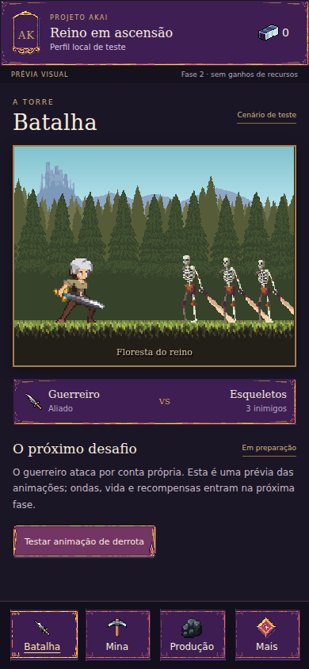

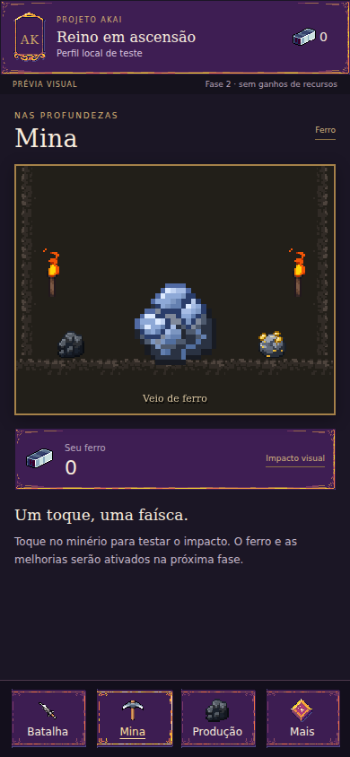

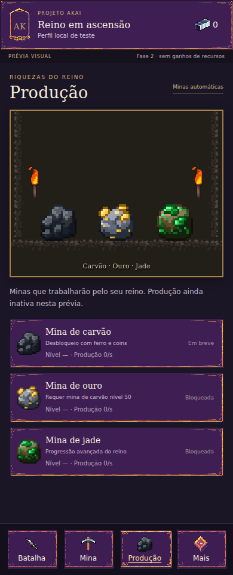
